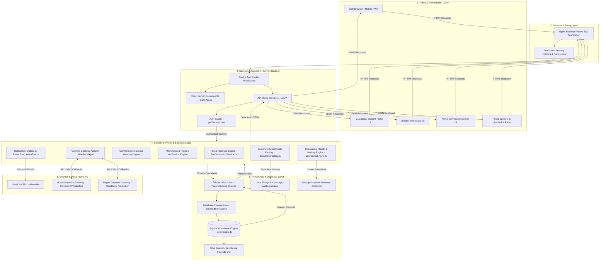
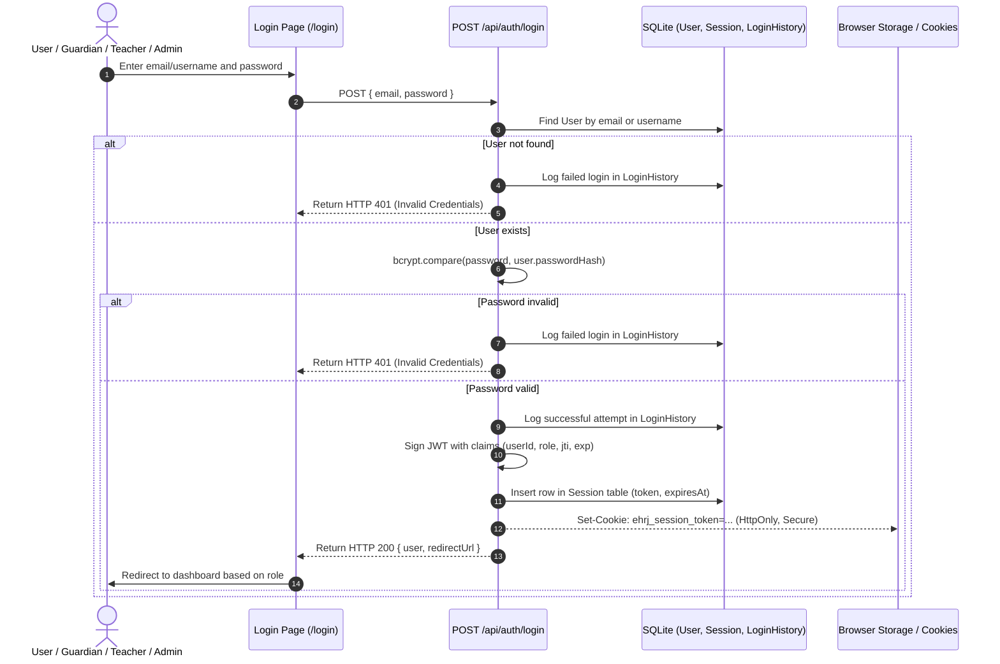
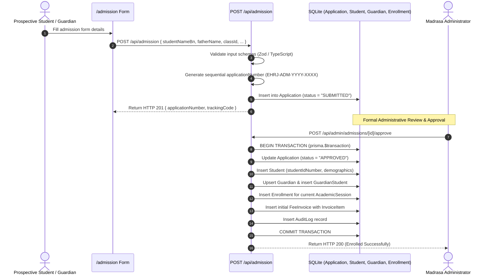
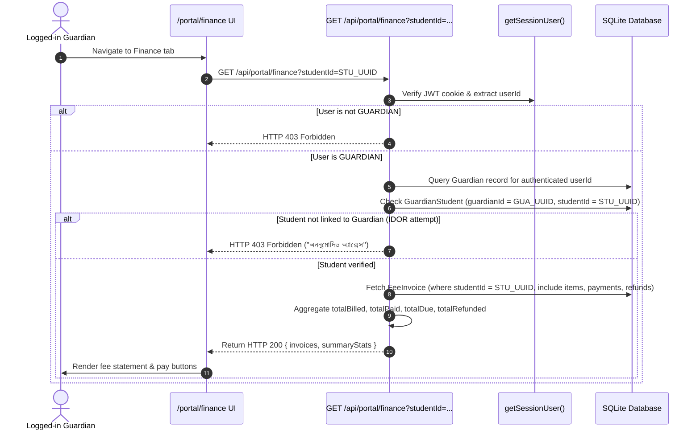
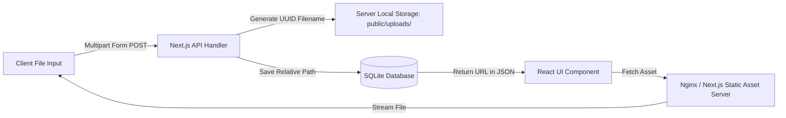
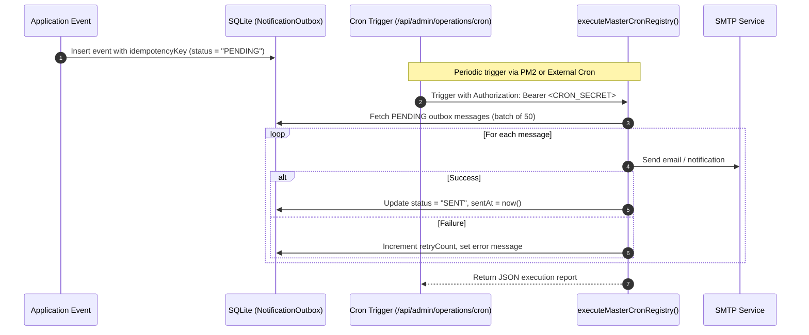

# Data Flow

## 1. Overview

The **EHRJ Digital Campus & ERP** is built on the **Next.js 14 App Router** fullstack framework. Data flows seamlessly from user interfaces (Server and Client Components) through authenticated API route handlers, domain service engines, and the Prisma Object-Relational Mapping (ORM) layer, ultimately persisting into an ACID-compliant **SQLite 3 database** operating in **Write-Ahead Logging (WAL)** mode.

The application enforces a **unidirectional, secure data pipeline**:
- Every client-initiated state mutation passes through server-side authentication (`getSessionUser`).
- Role-Based Access Control (RBAC) and object-level relational ownership boundaries (e.g., `GuardianStudent`, `TeacherAssignment`) are checked *before* any database query or mutation executes.
- High-stakes financial and academic operations are wrapped in atomic database transactions (`prisma.$transaction`), guaranteeing that multi-table state transitions either commit completely or roll back without leaving partial states.

---

## 2. System-Level Data Flow

The following Mermaid diagram traces the end-to-end movement of data across the client, proxy, application, domain services, database, and external integrations.

---

## 3. Authentication Flow

Authentication is managed via JSON Web Tokens (JWT) signed with the HMAC-SHA256 algorithm and stored in an `HttpOnly`, `SameSite=Lax` session cookie.

### Role-Based Redirection Target:
- `ADMIN`: Redirects to `/admin` (Executive administrative dashboard).
- `PRINCIPAL`: Redirects to `/principal` (Governance and policy cockpit).
- `TEACHER`: Redirects to `/teacher` (Assigned classes, attendance, marks).
- `GUARDIAN`: Redirects to `/portal` (Linked children, fee invoices, results).

---

## 4. Create Data Flow

### Example A: Online Student Admission Application

### Example B: Manual Online Fee Payment Submission
1. Guardian selects unpaid invoices in `/portal/finance` and inputs a mobile money TrxID (e.g. bKash/Nagad).
2. Client sends `POST /api/portal/finance/pay` with `allocations: [{ invoiceId, amount }]` and `transactionId`.
3. The server queries `GuardianStudent` to verify that the invoices belong to the logged-in guardian's ward (IDOR defense).
4. Server validates that the transaction ID has not been previously used (`paymentReceipt.findFirst({ where: { transactionId } })`).
5. **Core Invariant:** The payment record is inserted into `PaymentReceipt` with status `PENDING_VERIFICATION`. The invoice's `dueAmount` and `paidAmount` remain untouched until the institutional cashier reconciles the bank statement.

---

## 5. Read Data Flow

### Example: Guardian Financial Ledger Query (`/api/portal/finance`)

---

## 6. Update Data Flow

### Example: Teacher Submitting Class Attendance (`/api/teacher/attendance`)
1. Teacher selects Jamat, Section, and Date on `/teacher/attendance`.
2. Form submits `POST /api/teacher/attendance` with attendance status (`PRESENT`, `ABSENT`, `LATE`, `EXCUSED`) for each enrolled student.
3. **Teacher Scope Guard:** Server checks `verifyTeacherClassAssignment(userId, sessionId, classId, sectionId)`. If the teacher is not assigned to this class, the request is rejected with **HTTP 403 Forbidden**.
4. **Attendance Lock Guard:** Server checks if the date is beyond the editable lockout window in `AttendanceLock`. If locked and user is not Admin/Principal, update is blocked.
5. Server opens `prisma.$transaction`:
   - Iterates through students and upserts records in `Attendance`.
   - Records an `AuditLog` entry: `action = "TEACHER_ATTENDANCE_RECORDED"`.
6. Transaction commits and returns HTTP 200 with recorded count.

---

## 7. Delete / Lifecycle Transition Flow

In accordance with institutional compliance and Shariah auditing requirements, the EHRJ ERP avoids destructive hard deletions for operational records. Instead, it utilizes **explicit lifecycle status transitions**:

| Entity | "Deletion" Method | Resulting State | Historical Behavior |
| :--- | :--- | :--- | :--- |
| **Certificate** | Revocation | `isRevoked = true`, `status = "REVOKED"` | Verification URL returns `verified: false` and shows revocation reason. Historical row preserved. |
| **Fee Invoice** | Cancellation / Waiver | `status = "CANCELLED"` or `"WAIVED"` | Balance zeroed out; preserved in student financial ledger for auditing. |
| **Student** | Inactivation / Transfer | `status = "TRANSFERRED"` or `"INACTIVE"` | Historical enrollment, results, and fee transactions remain completely intact. |
| **Session** | User Logout | Hard deletion from `Session` table | Physically revokes JWT token; forces re-authentication. |

---

## 8. External Services Data Flow

### 1. Gmail SMTP Integration
- **Purpose:** Dispatching payment confirmation receipts, password reset links, and institutional notices.
- **Protocol:** TLS connection over port 587/465 to `smtp.gmail.com` via `nodemailer`.
- **Flow:** Domain service → `nodemailer.sendMail()` → Gmail SMTP Server → Recipient Inbox.
- **Fallback:** If SMTP fails, the notification is captured in `NotificationOutbox` with `status = "FAILED"` for automatic retry.

### 2. Payment Gateway Integrations (bKash & Nagad)
- **Initiate Flow:**
  - Guardian clicks "Pay Online" → `PaymentIntentService.createIntent()` creates a `PaymentIntent` record in `PENDING` state.
  - Calls bKash Tokenized Checkout API (`createPayment`) using credentials in environment variables.
  - Returns gateway payment URL to client for redirection.
- **Finalize / Callback Flow:**
  - Payer enters PIN on official gateway page.
  - Gateway redirects back to `/api/portal/finance/gateway/callback`.
  - Server invokes server-to-server `executePayment` API to authoritatively confirm settlement.
  - On gateway approval, `prisma.$transaction` updates `PaymentReceipt` to `SUCCESSFUL`, credits the designated `CashFund`, and decrements `FeeInvoice.dueAmount`.

---

## 9. File & Document Storage Flow

1. Files uploaded (e.g. Student photo, NID document, transfer certificate) are parsed in API handlers.
2. A sanitized filename with a cryptographic UUID is generated (e.g. `doc_1791194338872_a8b9c0.pdf`).
3. File is stored in `public/uploads/`.
4. The database stores the web-accessible URI in fields such as `Student.photoUrl` or `StudentDocument.fileUrl`.
5. Static delivery is served directly by the web server with caching headers.

---

## 10. Realtime & Background Processing Flow

### Cron & Outbox Processing Engine
Since SQLite cannot host background daemon threads, asynchronous jobs are handled through a **Transactional Outbox & Scheduled Cron Pattern**:

---

## 11. Security Boundaries

Security is enforced at 4 distinct architectural perimeters:
1. **Network Perimeter:** Nginx terminates TLS; enforces rate limiting on `/api/auth/*` and `/api/portal/finance/*`.
2. **Session Perimeter:** `getSessionUser()` decrypts and verifies JWT against the database session store, blocking unauthenticated traffic with HTTP 401.
3. **Role Perimeter:** API route guards inspect `user.role` against permitted roles (e.g., only `ADMIN` can access `/api/admin/*`).
4. **Data Ownership Perimeter:** Relational filtering ensures users cannot access or mutate unauthorized peer records (IDOR protection).

---

## 12. Important Data Transformations

1. **Qawmi Grade Thresholds:**
   - Evaluated in `src/lib/gradingEngine.ts`:
     - $ge 80.00%$ $
ightarrow$ **Mumtaz (মুমতাজ)**
     - $70.00% - 79.99%$ $
ightarrow$ **Jayyid Jiddan (জায়্যিদ জিদ্দান)**
     - $60.00% - 69.99%$ $
ightarrow$ **Jayyid (জায়্যিদ)**
     - $50.00% - 59.99%$ $
ightarrow$ **Maqbul (মাকবুল)**
     - $< 50.00%$ or mandatory subject failure $
ightarrow$ **Rasib (রাসিব)**
2. **Monetary Precision:** All currency calculations are normalized using `Math.round(amount * 100) / 100` to eliminate IEEE 754 floating-point rounding errors.
3. **Certificate Snapshot Freezing:** When a certificate is issued, student name, father name, jamat, roll, and session are serialized into an immutable JSON string (`snapshotJson`), shielding historical credentials from subsequent profile edits.

---

## 13. Unknown / Unverified Flows

1. **Persistent WebSocket Streams:** Live client-to-server WebSocket bidirectional messaging is not implemented; client interfaces rely on polling and standard HTTP request/response lifecycles.
2. **Offsite Cloud Storage Synchronization:** Automatic background synchronization of files in `public/uploads/` or `backups/` to cloud object storage (e.g. AWS S3, Cloudflare R2) is not currently active in deployment scripts.
