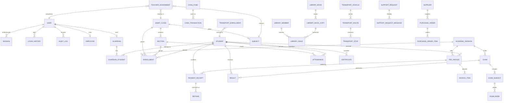

# Data Relationships

## 1. Relationship Overview

The **EHRJ Digital Campus & ERP** database architecture is designed with strict relational integrity, referential foreign key constraints, and relational access boundaries. The data model connects institutional stakeholders (administrators, principal, teachers, guardians, students) to academic routines, financial ledgers, grading pipelines, and operational facilities.

### Core Relational Patterns:
1. **One-to-Many (1:N) Hierarchies:**
   - Academic Structure: `AcademicSession` → `Enrollment`, `JamatClass` → `Section`, `JamatClass` → `Subject`.
   - Financial Ledger: `FeeInvoice` → `InvoiceItem`, `FeeInvoice` → `PaymentReceipt`, `CashFund` → `CashTransaction`.
   - Examination System: `Exam` → `ExamSubject` → `ExamMark`, `Student` → `Result`.
   - Logistics & Library: `LibraryBook` → `LibraryBookCopy`, `TransportRoute` → `TransportStop`, `PurchaseOrder` → `PurchaseOrderItem`.
2. **Many-to-Many (M:N) via Explicit Associative Tables:**
   - `GuardianStudent`: Resolves the M:N relationship between `Guardian` and `Student`, allowing a single parent to supervise multiple siblings, and multiple guardians (e.g. father, mother, local guardian) to link to a student.
   - `TeacherAssignment`: Resolves M:N allocations linking teachers to specific combinations of `AcademicSession`, `JamatClass`, `Section`, and `Subject`.
3. **Historical Snapshots (Decoupled Relations):**
   - `Certificate` maintains a formal foreign key to `Student`, but preserves historic state inside `snapshotJson` to guarantee that mutations to active student demographics never corrupt issued academic credentials.
4. **Referential Integrity & Cascades:**
   - Child records belonging strictly to a parent aggregate (`InvoiceItem` under `FeeInvoice`, `Session` under `User`, `ExamMark` under `ExamSubject`) use `onDelete: Cascade`.
   - Shared business assets and funds use default restrictive cascades to prevent accidental orphan deletions.

---

## 2. Entity Relationship Diagram

The following Mermaid ER diagram illustrates the verified relationships connecting the core institutional subsystems.

---

## 3. Relationship Details

Below is the verified mapping of all explicit foreign key relationships defined across the project's models.

### Session Relationships

#### `Session` → `User`
- **Relationship:** Many-to-One (`Session` belongs to `User`)
- **Foreign Key:** `userId` → `User.id`
- **On Delete Action:** `Cascade`
- **Purpose:** Binds `Session` authoritatively to its parent `User` entity.

### LoginHistory Relationships

#### `LoginHistory` → `User`
- **Relationship:** Many-to-One (`LoginHistory` belongs to `User`)
- **Foreign Key:** `userId` → `User.id`
- **On Delete Action:** `Cascade`
- **Purpose:** Binds `LoginHistory` authoritatively to its parent `User` entity.

### Section Relationships

#### `Section` → `JamatClass`
- **Relationship:** Many-to-One (`Section` belongs to `JamatClass`)
- **Foreign Key:** `classId` → `JamatClass.id`
- **On Delete Action:** `Cascade`
- **Purpose:** Binds `Section` authoritatively to its parent `JamatClass` entity.

### Subject Relationships

#### `Subject` → `JamatClass`
- **Relationship:** Many-to-One (`Subject` belongs to `JamatClass`)
- **Foreign Key:** `classId` → `JamatClass.id`
- **On Delete Action:** `Cascade`
- **Purpose:** Binds `Subject` authoritatively to its parent `JamatClass` entity.

### TeacherAssignment Relationships

#### `TeacherAssignment` → `User`
- **Relationship:** Many-to-One (`TeacherAssignment` belongs to `User`)
- **Foreign Key:** `teacherId` → `User.id`
- **On Delete Action:** `Cascade`
- **Purpose:** Binds `TeacherAssignment` authoritatively to its parent `User` entity.

#### `TeacherAssignment` → `AcademicSession`
- **Relationship:** Many-to-One (`TeacherAssignment` belongs to `AcademicSession`)
- **Foreign Key:** `sessionId` → `AcademicSession.id`
- **On Delete Action:** `Cascade`
- **Purpose:** Binds `TeacherAssignment` authoritatively to its parent `AcademicSession` entity.

#### `TeacherAssignment` → `Section?`
- **Relationship:** Many-to-One (`TeacherAssignment` belongs to `Section?`)
- **Foreign Key:** `sectionId` → `Section?.id`
- **On Delete Action:** `SetNull`
- **Purpose:** Binds `TeacherAssignment` authoritatively to its parent `Section?` entity.

#### `TeacherAssignment` → `Subject?`
- **Relationship:** Many-to-One (`TeacherAssignment` belongs to `Subject?`)
- **Foreign Key:** `subjectId` → `Subject?.id`
- **On Delete Action:** `SetNull`
- **Purpose:** Binds `TeacherAssignment` authoritatively to its parent `Subject?` entity.

### Guardian Relationships

#### `Guardian` → `User?`
- **Relationship:** Many-to-One (`Guardian` belongs to `User?`)
- **Foreign Key:** `userId` → `User?.id`
- **On Delete Action:** `SetNull`
- **Purpose:** Binds `Guardian` authoritatively to its parent `User?` entity.

### GuardianStudent Relationships

#### `GuardianStudent` → `Guardian`
- **Relationship:** Many-to-One (`GuardianStudent` belongs to `Guardian`)
- **Foreign Key:** `guardianId` → `Guardian.id`
- **On Delete Action:** `Cascade`
- **Purpose:** Binds `GuardianStudent` authoritatively to its parent `Guardian` entity.

#### `GuardianStudent` → `Student`
- **Relationship:** Many-to-One (`GuardianStudent` belongs to `Student`)
- **Foreign Key:** `studentId` → `Student.id`
- **On Delete Action:** `Cascade`
- **Purpose:** Binds `GuardianStudent` authoritatively to its parent `Student` entity.

### Enrollment Relationships

#### `Enrollment` → `Student`
- **Relationship:** Many-to-One (`Enrollment` belongs to `Student`)
- **Foreign Key:** `studentId` → `Student.id`
- **On Delete Action:** `Cascade`
- **Purpose:** Binds `Enrollment` authoritatively to its parent `Student` entity.

#### `Enrollment` → `AcademicSession`
- **Relationship:** Many-to-One (`Enrollment` belongs to `AcademicSession`)
- **Foreign Key:** `sessionId` → `AcademicSession.id`
- **On Delete Action:** `Cascade`
- **Purpose:** Binds `Enrollment` authoritatively to its parent `AcademicSession` entity.

#### `Enrollment` → `JamatClass`
- **Relationship:** Many-to-One (`Enrollment` belongs to `JamatClass`)
- **Foreign Key:** `classId` → `JamatClass.id`
- **On Delete Action:** `Cascade`
- **Purpose:** Binds `Enrollment` authoritatively to its parent `JamatClass` entity.

#### `Enrollment` → `Section?`
- **Relationship:** Many-to-One (`Enrollment` belongs to `Section?`)
- **Foreign Key:** `sectionId` → `Section?.id`
- **On Delete Action:** `SetNull`
- **Purpose:** Binds `Enrollment` authoritatively to its parent `Section?` entity.

### StudentDocument Relationships

#### `StudentDocument` → `Student`
- **Relationship:** Many-to-One (`StudentDocument` belongs to `Student`)
- **Foreign Key:** `studentId` → `Student.id`
- **On Delete Action:** `Cascade`
- **Purpose:** Binds `StudentDocument` authoritatively to its parent `Student` entity.

### Attendance Relationships

#### `Attendance` → `Student`
- **Relationship:** Many-to-One (`Attendance` belongs to `Student`)
- **Foreign Key:** `studentId` → `Student.id`
- **On Delete Action:** `Cascade`
- **Purpose:** Binds `Attendance` authoritatively to its parent `Student` entity.

#### `Attendance` → `AcademicSession`
- **Relationship:** Many-to-One (`Attendance` belongs to `AcademicSession`)
- **Foreign Key:** `sessionId` → `AcademicSession.id`
- **On Delete Action:** `Cascade`
- **Purpose:** Binds `Attendance` authoritatively to its parent `AcademicSession` entity.

#### `Attendance` → `JamatClass`
- **Relationship:** Many-to-One (`Attendance` belongs to `JamatClass`)
- **Foreign Key:** `classId` → `JamatClass.id`
- **On Delete Action:** `Cascade`
- **Purpose:** Binds `Attendance` authoritatively to its parent `JamatClass` entity.

#### `Attendance` → `Section?`
- **Relationship:** Many-to-One (`Attendance` belongs to `Section?`)
- **Foreign Key:** `sectionId` → `Section?.id`
- **On Delete Action:** `SetNull`
- **Purpose:** Binds `Attendance` authoritatively to its parent `Section?` entity.

#### `Attendance` → `User?`
- **Relationship:** Many-to-One (`Attendance` belongs to `User?`)
- **Foreign Key:** `markedByUserId` → `User?.id`
- **On Delete Action:** `SetNull`
- **Purpose:** Binds `Attendance` authoritatively to its parent `User?` entity.

### AttendanceLock Relationships

#### `AttendanceLock` → `AcademicSession`
- **Relationship:** Many-to-One (`AttendanceLock` belongs to `AcademicSession`)
- **Foreign Key:** `sessionId` → `AcademicSession.id`
- **On Delete Action:** `Cascade`
- **Purpose:** Binds `AttendanceLock` authoritatively to its parent `AcademicSession` entity.

#### `AttendanceLock` → `JamatClass`
- **Relationship:** Many-to-One (`AttendanceLock` belongs to `JamatClass`)
- **Foreign Key:** `classId` → `JamatClass.id`
- **On Delete Action:** `Cascade`
- **Purpose:** Binds `AttendanceLock` authoritatively to its parent `JamatClass` entity.

#### `AttendanceLock` → `Section?`
- **Relationship:** Many-to-One (`AttendanceLock` belongs to `Section?`)
- **Foreign Key:** `sectionId` → `Section?.id`
- **On Delete Action:** `SetNull`
- **Purpose:** Binds `AttendanceLock` authoritatively to its parent `Section?` entity.

### Exam Relationships

#### `Exam` → `AcademicSession`
- **Relationship:** Many-to-One (`Exam` belongs to `AcademicSession`)
- **Foreign Key:** `sessionId` → `AcademicSession.id`
- **On Delete Action:** `Cascade`
- **Purpose:** Binds `Exam` authoritatively to its parent `AcademicSession` entity.

#### `Exam` → `ExamType?`
- **Relationship:** Many-to-One (`Exam` belongs to `ExamType?`)
- **Foreign Key:** `examTypeId` → `ExamType?.id`
- **On Delete Action:** `SetNull`
- **Purpose:** Binds `Exam` authoritatively to its parent `ExamType?` entity.

### ExamSubject Relationships

#### `ExamSubject` → `Exam`
- **Relationship:** Many-to-One (`ExamSubject` belongs to `Exam`)
- **Foreign Key:** `examId` → `Exam.id`
- **On Delete Action:** `Cascade`
- **Purpose:** Binds `ExamSubject` authoritatively to its parent `Exam` entity.

#### `ExamSubject` → `JamatClass`
- **Relationship:** Many-to-One (`ExamSubject` belongs to `JamatClass`)
- **Foreign Key:** `classId` → `JamatClass.id`
- **On Delete Action:** `Cascade`
- **Purpose:** Binds `ExamSubject` authoritatively to its parent `JamatClass` entity.

#### `ExamSubject` → `Subject`
- **Relationship:** Many-to-One (`ExamSubject` belongs to `Subject`)
- **Foreign Key:** `subjectId` → `Subject.id`
- **On Delete Action:** `Cascade`
- **Purpose:** Binds `ExamSubject` authoritatively to its parent `Subject` entity.

### ExamRoutine Relationships

#### `ExamRoutine` → `Exam`
- **Relationship:** Many-to-One (`ExamRoutine` belongs to `Exam`)
- **Foreign Key:** `examId` → `Exam.id`
- **On Delete Action:** `Cascade`
- **Purpose:** Binds `ExamRoutine` authoritatively to its parent `Exam` entity.

#### `ExamRoutine` → `JamatClass`
- **Relationship:** Many-to-One (`ExamRoutine` belongs to `JamatClass`)
- **Foreign Key:** `classId` → `JamatClass.id`
- **On Delete Action:** `Cascade`
- **Purpose:** Binds `ExamRoutine` authoritatively to its parent `JamatClass` entity.

#### `ExamRoutine` → `Section?`
- **Relationship:** Many-to-One (`ExamRoutine` belongs to `Section?`)
- **Foreign Key:** `sectionId` → `Section?.id`
- **On Delete Action:** `SetNull`
- **Purpose:** Binds `ExamRoutine` authoritatively to its parent `Section?` entity.

#### `ExamRoutine` → `Subject`
- **Relationship:** Many-to-One (`ExamRoutine` belongs to `Subject`)
- **Foreign Key:** `subjectId` → `Subject.id`
- **On Delete Action:** `Cascade`
- **Purpose:** Binds `ExamRoutine` authoritatively to its parent `Subject` entity.

### AdmitCard Relationships

#### `AdmitCard` → `Exam`
- **Relationship:** Many-to-One (`AdmitCard` belongs to `Exam`)
- **Foreign Key:** `examId` → `Exam.id`
- **On Delete Action:** `Cascade`
- **Purpose:** Binds `AdmitCard` authoritatively to its parent `Exam` entity.

#### `AdmitCard` → `Student`
- **Relationship:** Many-to-One (`AdmitCard` belongs to `Student`)
- **Foreign Key:** `studentId` → `Student.id`
- **On Delete Action:** `Cascade`
- **Purpose:** Binds `AdmitCard` authoritatively to its parent `Student` entity.

### ExamMark Relationships

#### `ExamMark` → `Exam`
- **Relationship:** Many-to-One (`ExamMark` belongs to `Exam`)
- **Foreign Key:** `examId` → `Exam.id`
- **On Delete Action:** `Cascade`
- **Purpose:** Binds `ExamMark` authoritatively to its parent `Exam` entity.

#### `ExamMark` → `Student`
- **Relationship:** Many-to-One (`ExamMark` belongs to `Student`)
- **Foreign Key:** `studentId` → `Student.id`
- **On Delete Action:** `Cascade`
- **Purpose:** Binds `ExamMark` authoritatively to its parent `Student` entity.

#### `ExamMark` → `Subject`
- **Relationship:** Many-to-One (`ExamMark` belongs to `Subject`)
- **Foreign Key:** `subjectId` → `Subject.id`
- **On Delete Action:** `Cascade`
- **Purpose:** Binds `ExamMark` authoritatively to its parent `Subject` entity.

### Result Relationships

#### `Result` → `Exam`
- **Relationship:** Many-to-One (`Result` belongs to `Exam`)
- **Foreign Key:** `examId` → `Exam.id`
- **On Delete Action:** `Cascade`
- **Purpose:** Binds `Result` authoritatively to its parent `Exam` entity.

#### `Result` → `Student`
- **Relationship:** Many-to-One (`Result` belongs to `Student`)
- **Foreign Key:** `studentId` → `Student.id`
- **On Delete Action:** `Cascade`
- **Purpose:** Binds `Result` authoritatively to its parent `Student` entity.

### FeeInvoice Relationships

#### `FeeInvoice` → `Student`
- **Relationship:** Many-to-One (`FeeInvoice` belongs to `Student`)
- **Foreign Key:** `studentId` → `Student.id`
- **On Delete Action:** `Cascade`
- **Purpose:** Binds `FeeInvoice` authoritatively to its parent `Student` entity.

#### `FeeInvoice` → `AcademicSession`
- **Relationship:** Many-to-One (`FeeInvoice` belongs to `AcademicSession`)
- **Foreign Key:** `sessionId` → `AcademicSession.id`
- **On Delete Action:** `Cascade`
- **Purpose:** Binds `FeeInvoice` authoritatively to its parent `AcademicSession` entity.

### InvoiceItem Relationships

#### `InvoiceItem` → `FeeInvoice`
- **Relationship:** Many-to-One (`InvoiceItem` belongs to `FeeInvoice`)
- **Foreign Key:** `invoiceId` → `FeeInvoice.id`
- **On Delete Action:** `Cascade`
- **Purpose:** Binds `InvoiceItem` authoritatively to its parent `FeeInvoice` entity.

#### `InvoiceItem` → `FeeCategory`
- **Relationship:** Many-to-One (`InvoiceItem` belongs to `FeeCategory`)
- **Foreign Key:** `feeCategoryId` → `FeeCategory.id`
- **On Delete Action:** `Cascade`
- **Purpose:** Binds `InvoiceItem` authoritatively to its parent `FeeCategory` entity.

### PaymentReceipt Relationships

#### `PaymentReceipt` → `FeeInvoice`
- **Relationship:** Many-to-One (`PaymentReceipt` belongs to `FeeInvoice`)
- **Foreign Key:** `invoiceId` → `FeeInvoice.id`
- **On Delete Action:** `Cascade`
- **Purpose:** Binds `PaymentReceipt` authoritatively to its parent `FeeInvoice` entity.

#### `PaymentReceipt` → `Student`
- **Relationship:** Many-to-One (`PaymentReceipt` belongs to `Student`)
- **Foreign Key:** `studentId` → `Student.id`
- **On Delete Action:** `Cascade`
- **Purpose:** Binds `PaymentReceipt` authoritatively to its parent `Student` entity.

### PaymentIntent Relationships

#### `PaymentIntent` → `FeeInvoice`
- **Relationship:** Many-to-One (`PaymentIntent` belongs to `FeeInvoice`)
- **Foreign Key:** `invoiceId` → `FeeInvoice.id`
- **On Delete Action:** `Cascade`
- **Purpose:** Binds `PaymentIntent` authoritatively to its parent `FeeInvoice` entity.

#### `PaymentIntent` → `Student`
- **Relationship:** Many-to-One (`PaymentIntent` belongs to `Student`)
- **Foreign Key:** `studentId` → `Student.id`
- **On Delete Action:** `Cascade`
- **Purpose:** Binds `PaymentIntent` authoritatively to its parent `Student` entity.

### FinancialAssistance Relationships

#### `FinancialAssistance` → `Student`
- **Relationship:** Many-to-One (`FinancialAssistance` belongs to `Student`)
- **Foreign Key:** `studentId` → `Student.id`
- **On Delete Action:** `Cascade`
- **Purpose:** Binds `FinancialAssistance` authoritatively to its parent `Student` entity.

#### `FinancialAssistance` → `AcademicSession`
- **Relationship:** Many-to-One (`FinancialAssistance` belongs to `AcademicSession`)
- **Foreign Key:** `sessionId` → `AcademicSession.id`
- **On Delete Action:** `Cascade`
- **Purpose:** Binds `FinancialAssistance` authoritatively to its parent `AcademicSession` entity.

### CashTransaction Relationships

#### `CashTransaction` → `CashFund`
- **Relationship:** Many-to-One (`CashTransaction` belongs to `CashFund`)
- **Foreign Key:** `fundId` → `CashFund.id`
- **On Delete Action:** `Cascade`
- **Purpose:** Binds `CashTransaction` authoritatively to its parent `CashFund` entity.

### FeeStructure Relationships

#### `FeeStructure` → `AcademicSession`
- **Relationship:** Many-to-One (`FeeStructure` belongs to `AcademicSession`)
- **Foreign Key:** `sessionId` → `AcademicSession.id`
- **On Delete Action:** `Cascade`
- **Purpose:** Binds `FeeStructure` authoritatively to its parent `AcademicSession` entity.

#### `FeeStructure` → `JamatClass?`
- **Relationship:** Many-to-One (`FeeStructure` belongs to `JamatClass?`)
- **Foreign Key:** `classId` → `JamatClass?.id`
- **On Delete Action:** `SetNull`
- **Purpose:** Binds `FeeStructure` authoritatively to its parent `JamatClass?` entity.

### Refund Relationships

#### `Refund` → `PaymentReceipt`
- **Relationship:** Many-to-One (`Refund` belongs to `PaymentReceipt`)
- **Foreign Key:** `paymentId` → `PaymentReceipt.id`
- **On Delete Action:** `Cascade`
- **Purpose:** Binds `Refund` authoritatively to its parent `PaymentReceipt` entity.

#### `Refund` → `FeeInvoice`
- **Relationship:** Many-to-One (`Refund` belongs to `FeeInvoice`)
- **Foreign Key:** `invoiceId` → `FeeInvoice.id`
- **On Delete Action:** `Cascade`
- **Purpose:** Binds `Refund` authoritatively to its parent `FeeInvoice` entity.

### StudentScholarship Relationships

#### `StudentScholarship` → `Scholarship`
- **Relationship:** Many-to-One (`StudentScholarship` belongs to `Scholarship`)
- **Foreign Key:** `scholarshipId` → `Scholarship.id`
- **On Delete Action:** `Cascade`
- **Purpose:** Binds `StudentScholarship` authoritatively to its parent `Scholarship` entity.

#### `StudentScholarship` → `Student`
- **Relationship:** Many-to-One (`StudentScholarship` belongs to `Student`)
- **Foreign Key:** `studentId` → `Student.id`
- **On Delete Action:** `Cascade`
- **Purpose:** Binds `StudentScholarship` authoritatively to its parent `Student` entity.

### PayrollRecord Relationships

#### `PayrollRecord` → `User`
- **Relationship:** Many-to-One (`PayrollRecord` belongs to `User`)
- **Foreign Key:** `userId` → `User.id`
- **On Delete Action:** `Cascade`
- **Purpose:** Binds `PayrollRecord` authoritatively to its parent `User` entity.

#### `PayrollRecord` → `Employee?`
- **Relationship:** Many-to-One (`PayrollRecord` belongs to `Employee?`)
- **Foreign Key:** `employeeId` → `Employee?.id`
- **On Delete Action:** `SetNull`
- **Purpose:** Binds `PayrollRecord` authoritatively to its parent `Employee?` entity.

### DocumentRequest Relationships

#### `DocumentRequest` → `Student`
- **Relationship:** Many-to-One (`DocumentRequest` belongs to `Student`)
- **Foreign Key:** `studentId` → `Student.id`
- **On Delete Action:** `Cascade`
- **Purpose:** Binds `DocumentRequest` authoritatively to its parent `Student` entity.

#### `DocumentRequest` → `Guardian?`
- **Relationship:** Many-to-One (`DocumentRequest` belongs to `Guardian?`)
- **Foreign Key:** `guardianId` → `Guardian?.id`
- **On Delete Action:** `SetNull`
- **Purpose:** Binds `DocumentRequest` authoritatively to its parent `Guardian?` entity.

#### `DocumentRequest` → `AcademicSession?`
- **Relationship:** Many-to-One (`DocumentRequest` belongs to `AcademicSession?`)
- **Foreign Key:** `sessionId` → `AcademicSession?.id`
- **On Delete Action:** `SetNull`
- **Purpose:** Binds `DocumentRequest` authoritatively to its parent `AcademicSession?` entity.

#### `DocumentRequest` → `User?`
- **Relationship:** Many-to-One (`DocumentRequest` belongs to `User?`)
- **Foreign Key:** `reviewedByUserId` → `User?.id`
- **On Delete Action:** `SetNull`
- **Purpose:** Binds `DocumentRequest` authoritatively to its parent `User?` entity.

#### `DocumentRequest` → `FeeInvoice?`
- **Relationship:** Many-to-One (`DocumentRequest` belongs to `FeeInvoice?`)
- **Foreign Key:** `feeInvoiceId` → `FeeInvoice?.id`
- **On Delete Action:** `SetNull`
- **Purpose:** Binds `DocumentRequest` authoritatively to its parent `FeeInvoice?` entity.

### Certificate Relationships

#### `Certificate` → `Student`
- **Relationship:** Many-to-One (`Certificate` belongs to `Student`)
- **Foreign Key:** `studentId` → `Student.id`
- **On Delete Action:** `Cascade`
- **Purpose:** Binds `Certificate` authoritatively to its parent `Student` entity.

#### `Certificate` → `AcademicSession?`
- **Relationship:** Many-to-One (`Certificate` belongs to `AcademicSession?`)
- **Foreign Key:** `sessionId` → `AcademicSession?.id`
- **On Delete Action:** `SetNull`
- **Purpose:** Binds `Certificate` authoritatively to its parent `AcademicSession?` entity.

#### `Certificate` → `DocumentRequest?`
- **Relationship:** Many-to-One (`Certificate` belongs to `DocumentRequest?`)
- **Foreign Key:** `requestId` → `DocumentRequest?.id`
- **On Delete Action:** `SetNull`
- **Purpose:** Binds `Certificate` authoritatively to its parent `DocumentRequest?` entity.

#### `Certificate` → `DocumentTemplate?`
- **Relationship:** Many-to-One (`Certificate` belongs to `DocumentTemplate?`)
- **Foreign Key:** `templateId` → `DocumentTemplate?.id`
- **On Delete Action:** `SetNull`
- **Purpose:** Binds `Certificate` authoritatively to its parent `DocumentTemplate?` entity.

#### `Certificate` → `User?`
- **Relationship:** Many-to-One (`Certificate` belongs to `User?`)
- **Foreign Key:** `issuedByUserId` → `User?.id`
- **On Delete Action:** `SetNull`
- **Purpose:** Binds `Certificate` authoritatively to its parent `User?` entity.

#### `Certificate` → `User?`
- **Relationship:** Many-to-One (`Certificate` belongs to `User?`)
- **Foreign Key:** `revokedByUserId` → `User?.id`
- **On Delete Action:** `SetNull`
- **Purpose:** Binds `Certificate` authoritatively to its parent `User?` entity.

#### `Certificate` → `Certificate?`
- **Relationship:** Many-to-One (`Certificate` belongs to `Certificate?`)
- **Foreign Key:** `reissuedFromId` → `Certificate?.id`
- **On Delete Action:** `SetNull`
- **Purpose:** Binds `Certificate` authoritatively to its parent `Certificate?` entity.

### Notice Relationships

#### `Notice` → `AcademicSession?`
- **Relationship:** Many-to-One (`Notice` belongs to `AcademicSession?`)
- **Foreign Key:** `sessionId` → `AcademicSession?.id`
- **On Delete Action:** `SetNull`
- **Purpose:** Binds `Notice` authoritatively to its parent `AcademicSession?` entity.

#### `Notice` → `JamatClass?`
- **Relationship:** Many-to-One (`Notice` belongs to `JamatClass?`)
- **Foreign Key:** `classId` → `JamatClass?.id`
- **On Delete Action:** `SetNull`
- **Purpose:** Binds `Notice` authoritatively to its parent `JamatClass?` entity.

#### `Notice` → `Section?`
- **Relationship:** Many-to-One (`Notice` belongs to `Section?`)
- **Foreign Key:** `sectionId` → `Section?.id`
- **On Delete Action:** `SetNull`
- **Purpose:** Binds `Notice` authoritatively to its parent `Section?` entity.

#### `Notice` → `User?`
- **Relationship:** Many-to-One (`Notice` belongs to `User?`)
- **Foreign Key:** `createdByUserId` → `User?.id`
- **On Delete Action:** `SetNull`
- **Purpose:** Binds `Notice` authoritatively to its parent `User?` entity.

#### `Notice` → `User?`
- **Relationship:** Many-to-One (`Notice` belongs to `User?`)
- **Foreign Key:** `publishedByUserId` → `User?.id`
- **On Delete Action:** `SetNull`
- **Purpose:** Binds `Notice` authoritatively to its parent `User?` entity.

### Notification Relationships

#### `Notification` → `User`
- **Relationship:** Many-to-One (`Notification` belongs to `User`)
- **Foreign Key:** `recipientUserId` → `User.id`
- **On Delete Action:** `Cascade`
- **Purpose:** Binds `Notification` authoritatively to its parent `User` entity.

### NotificationDelivery Relationships

#### `NotificationDelivery` → `Notification?`
- **Relationship:** Many-to-One (`NotificationDelivery` belongs to `Notification?`)
- **Foreign Key:** `notificationId` → `Notification?.id`
- **On Delete Action:** `Cascade`
- **Purpose:** Binds `NotificationDelivery` authoritatively to its parent `Notification?` entity.

### NotificationPreference Relationships

#### `NotificationPreference` → `User`
- **Relationship:** Many-to-One (`NotificationPreference` belongs to `User`)
- **Foreign Key:** `userId` → `User.id`
- **On Delete Action:** `Cascade`
- **Purpose:** Binds `NotificationPreference` authoritatively to its parent `User` entity.

### AuditLog Relationships

#### `AuditLog` → `User?`
- **Relationship:** Many-to-One (`AuditLog` belongs to `User?`)
- **Foreign Key:** `userId` → `User?.id`
- **On Delete Action:** `SetNull`
- **Purpose:** Binds `AuditLog` authoritatively to its parent `User?` entity.

### LibraryBook Relationships

#### `LibraryBook` → `LibraryCategory`
- **Relationship:** Many-to-One (`LibraryBook` belongs to `LibraryCategory`)
- **Foreign Key:** `categoryId` → `LibraryCategory.id`
- **On Delete Action:** `NoAction`
- **Purpose:** Binds `LibraryBook` authoritatively to its parent `LibraryCategory` entity.

#### `LibraryBook` → `LibraryAuthor`
- **Relationship:** Many-to-One (`LibraryBook` belongs to `LibraryAuthor`)
- **Foreign Key:** `authorId` → `LibraryAuthor.id`
- **On Delete Action:** `NoAction`
- **Purpose:** Binds `LibraryBook` authoritatively to its parent `LibraryAuthor` entity.

#### `LibraryBook` → `LibraryPublisher?`
- **Relationship:** Many-to-One (`LibraryBook` belongs to `LibraryPublisher?`)
- **Foreign Key:** `publisherId` → `LibraryPublisher?.id`
- **On Delete Action:** `NoAction`
- **Purpose:** Binds `LibraryBook` authoritatively to its parent `LibraryPublisher?` entity.

### LibraryBookCopy Relationships

#### `LibraryBookCopy` → `LibraryBook`
- **Relationship:** Many-to-One (`LibraryBookCopy` belongs to `LibraryBook`)
- **Foreign Key:** `bookId` → `LibraryBook.id`
- **On Delete Action:** `Cascade`
- **Purpose:** Binds `LibraryBookCopy` authoritatively to its parent `LibraryBook` entity.

### LibraryMember Relationships

#### `LibraryMember` → `Student?`
- **Relationship:** Many-to-One (`LibraryMember` belongs to `Student?`)
- **Foreign Key:** `studentId` → `Student?.id`
- **On Delete Action:** `SetNull`
- **Purpose:** Binds `LibraryMember` authoritatively to its parent `Student?` entity.

#### `LibraryMember` → `User?`
- **Relationship:** Many-to-One (`LibraryMember` belongs to `User?`)
- **Foreign Key:** `userId` → `User?.id`
- **On Delete Action:** `SetNull`
- **Purpose:** Binds `LibraryMember` authoritatively to its parent `User?` entity.

### LibraryIssue Relationships

#### `LibraryIssue` → `LibraryBook`
- **Relationship:** Many-to-One (`LibraryIssue` belongs to `LibraryBook`)
- **Foreign Key:** `bookId` → `LibraryBook.id`
- **On Delete Action:** `NoAction`
- **Purpose:** Binds `LibraryIssue` authoritatively to its parent `LibraryBook` entity.

#### `LibraryIssue` → `LibraryBookCopy`
- **Relationship:** Many-to-One (`LibraryIssue` belongs to `LibraryBookCopy`)
- **Foreign Key:** `copyId` → `LibraryBookCopy.id`
- **On Delete Action:** `NoAction`
- **Purpose:** Binds `LibraryIssue` authoritatively to its parent `LibraryBookCopy` entity.

#### `LibraryIssue` → `LibraryMember`
- **Relationship:** Many-to-One (`LibraryIssue` belongs to `LibraryMember`)
- **Foreign Key:** `memberId` → `LibraryMember.id`
- **On Delete Action:** `NoAction`
- **Purpose:** Binds `LibraryIssue` authoritatively to its parent `LibraryMember` entity.

#### `LibraryIssue` → `User`
- **Relationship:** Many-to-One (`LibraryIssue` belongs to `User`)
- **Foreign Key:** `issuedByUserId` → `User.id`
- **On Delete Action:** `NoAction`
- **Purpose:** Binds `LibraryIssue` authoritatively to its parent `User` entity.

#### `LibraryIssue` → `FeeInvoice?`
- **Relationship:** Many-to-One (`LibraryIssue` belongs to `FeeInvoice?`)
- **Foreign Key:** `invoiceId` → `FeeInvoice?.id`
- **On Delete Action:** `SetNull`
- **Purpose:** Binds `LibraryIssue` authoritatively to its parent `FeeInvoice?` entity.

### LibraryRenewal Relationships

#### `LibraryRenewal` → `LibraryIssue`
- **Relationship:** Many-to-One (`LibraryRenewal` belongs to `LibraryIssue`)
- **Foreign Key:** `issueId` → `LibraryIssue.id`
- **On Delete Action:** `Cascade`
- **Purpose:** Binds `LibraryRenewal` authoritatively to its parent `LibraryIssue` entity.

#### `LibraryRenewal` → `User`
- **Relationship:** Many-to-One (`LibraryRenewal` belongs to `User`)
- **Foreign Key:** `renewedByUserId` → `User.id`
- **On Delete Action:** `NoAction`
- **Purpose:** Binds `LibraryRenewal` authoritatively to its parent `User` entity.

### LibraryConditionHistory Relationships

#### `LibraryConditionHistory` → `LibraryBookCopy`
- **Relationship:** Many-to-One (`LibraryConditionHistory` belongs to `LibraryBookCopy`)
- **Foreign Key:** `copyId` → `LibraryBookCopy.id`
- **On Delete Action:** `Cascade`
- **Purpose:** Binds `LibraryConditionHistory` authoritatively to its parent `LibraryBookCopy` entity.

#### `LibraryConditionHistory` → `User`
- **Relationship:** Many-to-One (`LibraryConditionHistory` belongs to `User`)
- **Foreign Key:** `recordedByUserId` → `User.id`
- **On Delete Action:** `NoAction`
- **Purpose:** Binds `LibraryConditionHistory` authoritatively to its parent `User` entity.

### ResidentialEnrollment Relationships

#### `ResidentialEnrollment` → `Student`
- **Relationship:** Many-to-One (`ResidentialEnrollment` belongs to `Student`)
- **Foreign Key:** `studentId` → `Student.id`
- **On Delete Action:** `Cascade`
- **Purpose:** Binds `ResidentialEnrollment` authoritatively to its parent `Student` entity.

#### `ResidentialEnrollment` → `AcademicSession`
- **Relationship:** Many-to-One (`ResidentialEnrollment` belongs to `AcademicSession`)
- **Foreign Key:** `sessionId` → `AcademicSession.id`
- **On Delete Action:** `Cascade`
- **Purpose:** Binds `ResidentialEnrollment` authoritatively to its parent `AcademicSession` entity.

#### `ResidentialEnrollment` → `User?`
- **Relationship:** Many-to-One (`ResidentialEnrollment` belongs to `User?`)
- **Foreign Key:** `createdById` → `User?.id`
- **On Delete Action:** `SetNull`
- **Purpose:** Binds `ResidentialEnrollment` authoritatively to its parent `User?` entity.

### ResidentialHistory Relationships

#### `ResidentialHistory` → `Student`
- **Relationship:** Many-to-One (`ResidentialHistory` belongs to `Student`)
- **Foreign Key:** `studentId` → `Student.id`
- **On Delete Action:** `Cascade`
- **Purpose:** Binds `ResidentialHistory` authoritatively to its parent `Student` entity.

#### `ResidentialHistory` → `ResidentialEnrollment?`
- **Relationship:** Many-to-One (`ResidentialHistory` belongs to `ResidentialEnrollment?`)
- **Foreign Key:** `enrollmentId` → `ResidentialEnrollment?.id`
- **On Delete Action:** `SetNull`
- **Purpose:** Binds `ResidentialHistory` authoritatively to its parent `ResidentialEnrollment?` entity.

#### `ResidentialHistory` → `AcademicSession`
- **Relationship:** Many-to-One (`ResidentialHistory` belongs to `AcademicSession`)
- **Foreign Key:** `sessionId` → `AcademicSession.id`
- **On Delete Action:** `Cascade`
- **Purpose:** Binds `ResidentialHistory` authoritatively to its parent `AcademicSession` entity.

#### `ResidentialHistory` → `User`
- **Relationship:** Many-to-One (`ResidentialHistory` belongs to `User`)
- **Foreign Key:** `recordedByUserId` → `User.id`
- **On Delete Action:** `NoAction`
- **Purpose:** Binds `ResidentialHistory` authoritatively to its parent `User` entity.

### ResidentialRequest Relationships

#### `ResidentialRequest` → `Student`
- **Relationship:** Many-to-One (`ResidentialRequest` belongs to `Student`)
- **Foreign Key:** `studentId` → `Student.id`
- **On Delete Action:** `Cascade`
- **Purpose:** Binds `ResidentialRequest` authoritatively to its parent `Student` entity.

#### `ResidentialRequest` → `Guardian`
- **Relationship:** Many-to-One (`ResidentialRequest` belongs to `Guardian`)
- **Foreign Key:** `guardianId` → `Guardian.id`
- **On Delete Action:** `Cascade`
- **Purpose:** Binds `ResidentialRequest` authoritatively to its parent `Guardian` entity.

#### `ResidentialRequest` → `AcademicSession`
- **Relationship:** Many-to-One (`ResidentialRequest` belongs to `AcademicSession`)
- **Foreign Key:** `sessionId` → `AcademicSession.id`
- **On Delete Action:** `Cascade`
- **Purpose:** Binds `ResidentialRequest` authoritatively to its parent `AcademicSession` entity.

#### `ResidentialRequest` → `User?`
- **Relationship:** Many-to-One (`ResidentialRequest` belongs to `User?`)
- **Foreign Key:** `reviewedByUserId` → `User?.id`
- **On Delete Action:** `SetNull`
- **Purpose:** Binds `ResidentialRequest` authoritatively to its parent `User?` entity.

### ResidentialRule Relationships

#### `ResidentialRule` → `AcademicSession`
- **Relationship:** Many-to-One (`ResidentialRule` belongs to `AcademicSession`)
- **Foreign Key:** `sessionId` → `AcademicSession.id`
- **On Delete Action:** `Cascade`
- **Purpose:** Binds `ResidentialRule` authoritatively to its parent `AcademicSession` entity.

### TransportDriver Relationships

#### `TransportDriver` → `Employee?`
- **Relationship:** Many-to-One (`TransportDriver` belongs to `Employee?`)
- **Foreign Key:** `employeeId` → `Employee?.id`
- **On Delete Action:** `SetNull`
- **Purpose:** Binds `TransportDriver` authoritatively to its parent `Employee?` entity.

### TransportVehicle Relationships

#### `TransportVehicle` → `TransportDriver?`
- **Relationship:** Many-to-One (`TransportVehicle` belongs to `TransportDriver?`)
- **Foreign Key:** `driverId` → `TransportDriver?.id`
- **On Delete Action:** `SetNull`
- **Purpose:** Binds `TransportVehicle` authoritatively to its parent `TransportDriver?` entity.

### TransportRoute Relationships

#### `TransportRoute` → `TransportVehicle?`
- **Relationship:** Many-to-One (`TransportRoute` belongs to `TransportVehicle?`)
- **Foreign Key:** `vehicleId` → `TransportVehicle?.id`
- **On Delete Action:** `SetNull`
- **Purpose:** Binds `TransportRoute` authoritatively to its parent `TransportVehicle?` entity.

### TransportStop Relationships

#### `TransportStop` → `TransportRoute`
- **Relationship:** Many-to-One (`TransportStop` belongs to `TransportRoute`)
- **Foreign Key:** `routeId` → `TransportRoute.id`
- **On Delete Action:** `Cascade`
- **Purpose:** Binds `TransportStop` authoritatively to its parent `TransportRoute` entity.

### TransportEnrollment Relationships

#### `TransportEnrollment` → `Student`
- **Relationship:** Many-to-One (`TransportEnrollment` belongs to `Student`)
- **Foreign Key:** `studentId` → `Student.id`
- **On Delete Action:** `Cascade`
- **Purpose:** Binds `TransportEnrollment` authoritatively to its parent `Student` entity.

#### `TransportEnrollment` → `AcademicSession`
- **Relationship:** Many-to-One (`TransportEnrollment` belongs to `AcademicSession`)
- **Foreign Key:** `sessionId` → `AcademicSession.id`
- **On Delete Action:** `Cascade`
- **Purpose:** Binds `TransportEnrollment` authoritatively to its parent `AcademicSession` entity.

#### `TransportEnrollment` → `TransportRoute`
- **Relationship:** Many-to-One (`TransportEnrollment` belongs to `TransportRoute`)
- **Foreign Key:** `routeId` → `TransportRoute.id`
- **On Delete Action:** `Restrict`
- **Purpose:** Binds `TransportEnrollment` authoritatively to its parent `TransportRoute` entity.

#### `TransportEnrollment` → `TransportStop`
- **Relationship:** Many-to-One (`TransportEnrollment` belongs to `TransportStop`)
- **Foreign Key:** `pickupStopId` → `TransportStop.id`
- **On Delete Action:** `Restrict`
- **Purpose:** Binds `TransportEnrollment` authoritatively to its parent `TransportStop` entity.

#### `TransportEnrollment` → `TransportStop?`
- **Relationship:** Many-to-One (`TransportEnrollment` belongs to `TransportStop?`)
- **Foreign Key:** `dropStopId` → `TransportStop?.id`
- **On Delete Action:** `SetNull`
- **Purpose:** Binds `TransportEnrollment` authoritatively to its parent `TransportStop?` entity.

### TransportRequest Relationships

#### `TransportRequest` → `Student`
- **Relationship:** Many-to-One (`TransportRequest` belongs to `Student`)
- **Foreign Key:** `studentId` → `Student.id`
- **On Delete Action:** `Cascade`
- **Purpose:** Binds `TransportRequest` authoritatively to its parent `Student` entity.

#### `TransportRequest` → `Guardian`
- **Relationship:** Many-to-One (`TransportRequest` belongs to `Guardian`)
- **Foreign Key:** `guardianId` → `Guardian.id`
- **On Delete Action:** `Cascade`
- **Purpose:** Binds `TransportRequest` authoritatively to its parent `Guardian` entity.

#### `TransportRequest` → `AcademicSession`
- **Relationship:** Many-to-One (`TransportRequest` belongs to `AcademicSession`)
- **Foreign Key:** `sessionId` → `AcademicSession.id`
- **On Delete Action:** `Cascade`
- **Purpose:** Binds `TransportRequest` authoritatively to its parent `AcademicSession` entity.

#### `TransportRequest` → `TransportRoute`
- **Relationship:** Many-to-One (`TransportRequest` belongs to `TransportRoute`)
- **Foreign Key:** `routeId` → `TransportRoute.id`
- **On Delete Action:** `Restrict`
- **Purpose:** Binds `TransportRequest` authoritatively to its parent `TransportRoute` entity.

#### `TransportRequest` → `TransportStop`
- **Relationship:** Many-to-One (`TransportRequest` belongs to `TransportStop`)
- **Foreign Key:** `pickupStopId` → `TransportStop.id`
- **On Delete Action:** `Restrict`
- **Purpose:** Binds `TransportRequest` authoritatively to its parent `TransportStop` entity.

#### `TransportRequest` → `TransportStop?`
- **Relationship:** Many-to-One (`TransportRequest` belongs to `TransportStop?`)
- **Foreign Key:** `dropStopId` → `TransportStop?.id`
- **On Delete Action:** `SetNull`
- **Purpose:** Binds `TransportRequest` authoritatively to its parent `TransportStop?` entity.

#### `TransportRequest` → `User?`
- **Relationship:** Many-to-One (`TransportRequest` belongs to `User?`)
- **Foreign Key:** `reviewedByUserId` → `User?.id`
- **On Delete Action:** `SetNull`
- **Purpose:** Binds `TransportRequest` authoritatively to its parent `User?` entity.

### TransportAssignmentHistory Relationships

#### `TransportAssignmentHistory` → `Student`
- **Relationship:** Many-to-One (`TransportAssignmentHistory` belongs to `Student`)
- **Foreign Key:** `studentId` → `Student.id`
- **On Delete Action:** `Cascade`
- **Purpose:** Binds `TransportAssignmentHistory` authoritatively to its parent `Student` entity.

#### `TransportAssignmentHistory` → `AcademicSession`
- **Relationship:** Many-to-One (`TransportAssignmentHistory` belongs to `AcademicSession`)
- **Foreign Key:** `sessionId` → `AcademicSession.id`
- **On Delete Action:** `Cascade`
- **Purpose:** Binds `TransportAssignmentHistory` authoritatively to its parent `AcademicSession` entity.

#### `TransportAssignmentHistory` → `TransportEnrollment?`
- **Relationship:** Many-to-One (`TransportAssignmentHistory` belongs to `TransportEnrollment?`)
- **Foreign Key:** `enrollmentId` → `TransportEnrollment?.id`
- **On Delete Action:** `SetNull`
- **Purpose:** Binds `TransportAssignmentHistory` authoritatively to its parent `TransportEnrollment?` entity.

#### `TransportAssignmentHistory` → `TransportRoute`
- **Relationship:** Many-to-One (`TransportAssignmentHistory` belongs to `TransportRoute`)
- **Foreign Key:** `routeId` → `TransportRoute.id`
- **On Delete Action:** `Restrict`
- **Purpose:** Binds `TransportAssignmentHistory` authoritatively to its parent `TransportRoute` entity.

#### `TransportAssignmentHistory` → `User`
- **Relationship:** Many-to-One (`TransportAssignmentHistory` belongs to `User`)
- **Foreign Key:** `recordedByUserId` → `User.id`
- **On Delete Action:** `NoAction`
- **Purpose:** Binds `TransportAssignmentHistory` authoritatively to its parent `User` entity.

### TransportRule Relationships

#### `TransportRule` → `AcademicSession`
- **Relationship:** Many-to-One (`TransportRule` belongs to `AcademicSession`)
- **Foreign Key:** `sessionId` → `AcademicSession.id`
- **On Delete Action:** `Cascade`
- **Purpose:** Binds `TransportRule` authoritatively to its parent `AcademicSession` entity.

### InventoryItem Relationships

#### `InventoryItem` → `InventoryCategory`
- **Relationship:** Many-to-One (`InventoryItem` belongs to `InventoryCategory`)
- **Foreign Key:** `categoryId` → `InventoryCategory.id`
- **On Delete Action:** `Restrict`
- **Purpose:** Binds `InventoryItem` authoritatively to its parent `InventoryCategory` entity.

### InventoryStockBalance Relationships

#### `InventoryStockBalance` → `InventoryItem`
- **Relationship:** Many-to-One (`InventoryStockBalance` belongs to `InventoryItem`)
- **Foreign Key:** `itemId` → `InventoryItem.id`
- **On Delete Action:** `Cascade`
- **Purpose:** Binds `InventoryStockBalance` authoritatively to its parent `InventoryItem` entity.

#### `InventoryStockBalance` → `InventoryLocation`
- **Relationship:** Many-to-One (`InventoryStockBalance` belongs to `InventoryLocation`)
- **Foreign Key:** `locationId` → `InventoryLocation.id`
- **On Delete Action:** `Cascade`
- **Purpose:** Binds `InventoryStockBalance` authoritatively to its parent `InventoryLocation` entity.

### InventoryTransaction Relationships

#### `InventoryTransaction` → `InventoryItem`
- **Relationship:** Many-to-One (`InventoryTransaction` belongs to `InventoryItem`)
- **Foreign Key:** `itemId` → `InventoryItem.id`
- **On Delete Action:** `Restrict`
- **Purpose:** Binds `InventoryTransaction` authoritatively to its parent `InventoryItem` entity.

#### `InventoryTransaction` → `InventoryLocation?`
- **Relationship:** Many-to-One (`InventoryTransaction` belongs to `InventoryLocation?`)
- **Foreign Key:** `sourceLocationId` → `InventoryLocation?.id`
- **On Delete Action:** `SetNull`
- **Purpose:** Binds `InventoryTransaction` authoritatively to its parent `InventoryLocation?` entity.

#### `InventoryTransaction` → `InventoryLocation?`
- **Relationship:** Many-to-One (`InventoryTransaction` belongs to `InventoryLocation?`)
- **Foreign Key:** `destLocationId` → `InventoryLocation?.id`
- **On Delete Action:** `SetNull`
- **Purpose:** Binds `InventoryTransaction` authoritatively to its parent `InventoryLocation?` entity.

#### `InventoryTransaction` → `User`
- **Relationship:** Many-to-One (`InventoryTransaction` belongs to `User`)
- **Foreign Key:** `recordedByUserId` → `User.id`
- **On Delete Action:** `NoAction`
- **Purpose:** Binds `InventoryTransaction` authoritatively to its parent `User` entity.

### PurchaseRequest Relationships

#### `PurchaseRequest` → `User`
- **Relationship:** Many-to-One (`PurchaseRequest` belongs to `User`)
- **Foreign Key:** `requestedByUserId` → `User.id`
- **On Delete Action:** `NoAction`
- **Purpose:** Binds `PurchaseRequest` authoritatively to its parent `User` entity.

#### `PurchaseRequest` → `User?`
- **Relationship:** Many-to-One (`PurchaseRequest` belongs to `User?`)
- **Foreign Key:** `reviewedByUserId` → `User?.id`
- **On Delete Action:** `SetNull`
- **Purpose:** Binds `PurchaseRequest` authoritatively to its parent `User?` entity.

### PurchaseRequestItem Relationships

#### `PurchaseRequestItem` → `PurchaseRequest`
- **Relationship:** Many-to-One (`PurchaseRequestItem` belongs to `PurchaseRequest`)
- **Foreign Key:** `requestId` → `PurchaseRequest.id`
- **On Delete Action:** `Cascade`
- **Purpose:** Binds `PurchaseRequestItem` authoritatively to its parent `PurchaseRequest` entity.

#### `PurchaseRequestItem` → `InventoryItem`
- **Relationship:** Many-to-One (`PurchaseRequestItem` belongs to `InventoryItem`)
- **Foreign Key:** `itemId` → `InventoryItem.id`
- **On Delete Action:** `Restrict`
- **Purpose:** Binds `PurchaseRequestItem` authoritatively to its parent `InventoryItem` entity.

### PurchaseOrder Relationships

#### `PurchaseOrder` → `Supplier`
- **Relationship:** Many-to-One (`PurchaseOrder` belongs to `Supplier`)
- **Foreign Key:** `supplierId` → `Supplier.id`
- **On Delete Action:** `Restrict`
- **Purpose:** Binds `PurchaseOrder` authoritatively to its parent `Supplier` entity.

#### `PurchaseOrder` → `PurchaseRequest?`
- **Relationship:** Many-to-One (`PurchaseOrder` belongs to `PurchaseRequest?`)
- **Foreign Key:** `purchaseRequestId` → `PurchaseRequest?.id`
- **On Delete Action:** `SetNull`
- **Purpose:** Binds `PurchaseOrder` authoritatively to its parent `PurchaseRequest?` entity.

#### `PurchaseOrder` → `User?`
- **Relationship:** Many-to-One (`PurchaseOrder` belongs to `User?`)
- **Foreign Key:** `approvedByUserId` → `User?.id`
- **On Delete Action:** `SetNull`
- **Purpose:** Binds `PurchaseOrder` authoritatively to its parent `User?` entity.

#### `PurchaseOrder` → `User`
- **Relationship:** Many-to-One (`PurchaseOrder` belongs to `User`)
- **Foreign Key:** `createdById` → `User.id`
- **On Delete Action:** `NoAction`
- **Purpose:** Binds `PurchaseOrder` authoritatively to its parent `User` entity.

### PurchaseOrderItem Relationships

#### `PurchaseOrderItem` → `PurchaseOrder`
- **Relationship:** Many-to-One (`PurchaseOrderItem` belongs to `PurchaseOrder`)
- **Foreign Key:** `purchaseOrderId` → `PurchaseOrder.id`
- **On Delete Action:** `Cascade`
- **Purpose:** Binds `PurchaseOrderItem` authoritatively to its parent `PurchaseOrder` entity.

#### `PurchaseOrderItem` → `InventoryItem`
- **Relationship:** Many-to-One (`PurchaseOrderItem` belongs to `InventoryItem`)
- **Foreign Key:** `itemId` → `InventoryItem.id`
- **On Delete Action:** `Restrict`
- **Purpose:** Binds `PurchaseOrderItem` authoritatively to its parent `InventoryItem` entity.

### GoodsReceipt Relationships

#### `GoodsReceipt` → `PurchaseOrder`
- **Relationship:** Many-to-One (`GoodsReceipt` belongs to `PurchaseOrder`)
- **Foreign Key:** `purchaseOrderId` → `PurchaseOrder.id`
- **On Delete Action:** `Restrict`
- **Purpose:** Binds `GoodsReceipt` authoritatively to its parent `PurchaseOrder` entity.

#### `GoodsReceipt` → `User`
- **Relationship:** Many-to-One (`GoodsReceipt` belongs to `User`)
- **Foreign Key:** `receivedByUserId` → `User.id`
- **On Delete Action:** `NoAction`
- **Purpose:** Binds `GoodsReceipt` authoritatively to its parent `User` entity.

### GoodsReceiptItem Relationships

#### `GoodsReceiptItem` → `GoodsReceipt`
- **Relationship:** Many-to-One (`GoodsReceiptItem` belongs to `GoodsReceipt`)
- **Foreign Key:** `goodsReceiptId` → `GoodsReceipt.id`
- **On Delete Action:** `Cascade`
- **Purpose:** Binds `GoodsReceiptItem` authoritatively to its parent `GoodsReceipt` entity.

#### `GoodsReceiptItem` → `PurchaseOrderItem?`
- **Relationship:** Many-to-One (`GoodsReceiptItem` belongs to `PurchaseOrderItem?`)
- **Foreign Key:** `purchaseOrderItemId` → `PurchaseOrderItem?.id`
- **On Delete Action:** `SetNull`
- **Purpose:** Binds `GoodsReceiptItem` authoritatively to its parent `PurchaseOrderItem?` entity.

#### `GoodsReceiptItem` → `InventoryItem`
- **Relationship:** Many-to-One (`GoodsReceiptItem` belongs to `InventoryItem`)
- **Foreign Key:** `itemId` → `InventoryItem.id`
- **On Delete Action:** `Restrict`
- **Purpose:** Binds `GoodsReceiptItem` authoritatively to its parent `InventoryItem` entity.

### InventoryAsset Relationships

#### `InventoryAsset` → `InventoryItem`
- **Relationship:** Many-to-One (`InventoryAsset` belongs to `InventoryItem`)
- **Foreign Key:** `itemId` → `InventoryItem.id`
- **On Delete Action:** `Restrict`
- **Purpose:** Binds `InventoryAsset` authoritatively to its parent `InventoryItem` entity.

#### `InventoryAsset` → `InventoryLocation`
- **Relationship:** Many-to-One (`InventoryAsset` belongs to `InventoryLocation`)
- **Foreign Key:** `locationId` → `InventoryLocation.id`
- **On Delete Action:** `Restrict`
- **Purpose:** Binds `InventoryAsset` authoritatively to its parent `InventoryLocation` entity.

#### `InventoryAsset` → `Supplier?`
- **Relationship:** Many-to-One (`InventoryAsset` belongs to `Supplier?`)
- **Foreign Key:** `supplierId` → `Supplier?.id`
- **On Delete Action:** `SetNull`
- **Purpose:** Binds `InventoryAsset` authoritatively to its parent `Supplier?` entity.

#### `InventoryAsset` → `User?`
- **Relationship:** Many-to-One (`InventoryAsset` belongs to `User?`)
- **Foreign Key:** `assignedUserId` → `User?.id`
- **On Delete Action:** `SetNull`
- **Purpose:** Binds `InventoryAsset` authoritatively to its parent `User?` entity.

#### `InventoryAsset` → `Employee?`
- **Relationship:** Many-to-One (`InventoryAsset` belongs to `Employee?`)
- **Foreign Key:** `assignedEmployeeId` → `Employee?.id`
- **On Delete Action:** `SetNull`
- **Purpose:** Binds `InventoryAsset` authoritatively to its parent `Employee?` entity.

### AssetAssignmentHistory Relationships

#### `AssetAssignmentHistory` → `InventoryAsset`
- **Relationship:** Many-to-One (`AssetAssignmentHistory` belongs to `InventoryAsset`)
- **Foreign Key:** `assetId` → `InventoryAsset.id`
- **On Delete Action:** `Cascade`
- **Purpose:** Binds `AssetAssignmentHistory` authoritatively to its parent `InventoryAsset` entity.

#### `AssetAssignmentHistory` → `User`
- **Relationship:** Many-to-One (`AssetAssignmentHistory` belongs to `User`)
- **Foreign Key:** `assignedByUserId` → `User.id`
- **On Delete Action:** `NoAction`
- **Purpose:** Binds `AssetAssignmentHistory` authoritatively to its parent `User` entity.

#### `AssetAssignmentHistory` → `Employee?`
- **Relationship:** Many-to-One (`AssetAssignmentHistory` belongs to `Employee?`)
- **Foreign Key:** `assignedEmployeeId` → `Employee?.id`
- **On Delete Action:** `SetNull`
- **Purpose:** Binds `AssetAssignmentHistory` authoritatively to its parent `Employee?` entity.

### AssetConditionHistory Relationships

#### `AssetConditionHistory` → `InventoryAsset`
- **Relationship:** Many-to-One (`AssetConditionHistory` belongs to `InventoryAsset`)
- **Foreign Key:** `assetId` → `InventoryAsset.id`
- **On Delete Action:** `Cascade`
- **Purpose:** Binds `AssetConditionHistory` authoritatively to its parent `InventoryAsset` entity.

#### `AssetConditionHistory` → `User`
- **Relationship:** Many-to-One (`AssetConditionHistory` belongs to `User`)
- **Foreign Key:** `recordedByUserId` → `User.id`
- **On Delete Action:** `NoAction`
- **Purpose:** Binds `AssetConditionHistory` authoritatively to its parent `User` entity.

### Employee Relationships

#### `Employee` → `User?`
- **Relationship:** Many-to-One (`Employee` belongs to `User?`)
- **Foreign Key:** `userId` → `User?.id`
- **On Delete Action:** `SetNull`
- **Purpose:** Binds `Employee` authoritatively to its parent `User?` entity.

#### `Employee` → `EmployeeDepartment?`
- **Relationship:** Many-to-One (`Employee` belongs to `EmployeeDepartment?`)
- **Foreign Key:** `departmentId` → `EmployeeDepartment?.id`
- **On Delete Action:** `SetNull`
- **Purpose:** Binds `Employee` authoritatively to its parent `EmployeeDepartment?` entity.

#### `Employee` → `EmployeeDesignation?`
- **Relationship:** Many-to-One (`Employee` belongs to `EmployeeDesignation?`)
- **Foreign Key:** `designationId` → `EmployeeDesignation?.id`
- **On Delete Action:** `SetNull`
- **Purpose:** Binds `Employee` authoritatively to its parent `EmployeeDesignation?` entity.

### EmployeeEmploymentHistory Relationships

#### `EmployeeEmploymentHistory` → `Employee`
- **Relationship:** Many-to-One (`EmployeeEmploymentHistory` belongs to `Employee`)
- **Foreign Key:** `employeeId` → `Employee.id`
- **On Delete Action:** `Cascade`
- **Purpose:** Binds `EmployeeEmploymentHistory` authoritatively to its parent `Employee` entity.

#### `EmployeeEmploymentHistory` → `User`
- **Relationship:** Many-to-One (`EmployeeEmploymentHistory` belongs to `User`)
- **Foreign Key:** `recordedByUserId` → `User.id`
- **On Delete Action:** `NoAction`
- **Purpose:** Binds `EmployeeEmploymentHistory` authoritatively to its parent `User` entity.

### EmployeeQualification Relationships

#### `EmployeeQualification` → `Employee`
- **Relationship:** Many-to-One (`EmployeeQualification` belongs to `Employee`)
- **Foreign Key:** `employeeId` → `Employee.id`
- **On Delete Action:** `Cascade`
- **Purpose:** Binds `EmployeeQualification` authoritatively to its parent `Employee` entity.

### EmployeeDocument Relationships

#### `EmployeeDocument` → `Employee`
- **Relationship:** Many-to-One (`EmployeeDocument` belongs to `Employee`)
- **Foreign Key:** `employeeId` → `Employee.id`
- **On Delete Action:** `Cascade`
- **Purpose:** Binds `EmployeeDocument` authoritatively to its parent `Employee` entity.

#### `EmployeeDocument` → `User`
- **Relationship:** Many-to-One (`EmployeeDocument` belongs to `User`)
- **Foreign Key:** `uploadedByUserId` → `User.id`
- **On Delete Action:** `NoAction`
- **Purpose:** Binds `EmployeeDocument` authoritatively to its parent `User` entity.

### EmployeeLeaveBalance Relationships

#### `EmployeeLeaveBalance` → `Employee`
- **Relationship:** Many-to-One (`EmployeeLeaveBalance` belongs to `Employee`)
- **Foreign Key:** `employeeId` → `Employee.id`
- **On Delete Action:** `Cascade`
- **Purpose:** Binds `EmployeeLeaveBalance` authoritatively to its parent `Employee` entity.

#### `EmployeeLeaveBalance` → `EmployeeLeaveType`
- **Relationship:** Many-to-One (`EmployeeLeaveBalance` belongs to `EmployeeLeaveType`)
- **Foreign Key:** `leaveTypeId` → `EmployeeLeaveType.id`
- **On Delete Action:** `Cascade`
- **Purpose:** Binds `EmployeeLeaveBalance` authoritatively to its parent `EmployeeLeaveType` entity.

### EmployeeLeaveRequest Relationships

#### `EmployeeLeaveRequest` → `Employee`
- **Relationship:** Many-to-One (`EmployeeLeaveRequest` belongs to `Employee`)
- **Foreign Key:** `employeeId` → `Employee.id`
- **On Delete Action:** `Cascade`
- **Purpose:** Binds `EmployeeLeaveRequest` authoritatively to its parent `Employee` entity.

#### `EmployeeLeaveRequest` → `EmployeeLeaveType`
- **Relationship:** Many-to-One (`EmployeeLeaveRequest` belongs to `EmployeeLeaveType`)
- **Foreign Key:** `leaveTypeId` → `EmployeeLeaveType.id`
- **On Delete Action:** `Restrict`
- **Purpose:** Binds `EmployeeLeaveRequest` authoritatively to its parent `EmployeeLeaveType` entity.

#### `EmployeeLeaveRequest` → `User?`
- **Relationship:** Many-to-One (`EmployeeLeaveRequest` belongs to `User?`)
- **Foreign Key:** `reviewedByUserId` → `User?.id`
- **On Delete Action:** `SetNull`
- **Purpose:** Binds `EmployeeLeaveRequest` authoritatively to its parent `User?` entity.

### EmployeeAttendanceRecord Relationships

#### `EmployeeAttendanceRecord` → `Employee`
- **Relationship:** Many-to-One (`EmployeeAttendanceRecord` belongs to `Employee`)
- **Foreign Key:** `employeeId` → `Employee.id`
- **On Delete Action:** `Cascade`
- **Purpose:** Binds `EmployeeAttendanceRecord` authoritatively to its parent `Employee` entity.

#### `EmployeeAttendanceRecord` → `User`
- **Relationship:** Many-to-One (`EmployeeAttendanceRecord` belongs to `User`)
- **Foreign Key:** `recordedByUserId` → `User.id`
- **On Delete Action:** `NoAction`
- **Purpose:** Binds `EmployeeAttendanceRecord` authoritatively to its parent `User` entity.

### SupportRequest Relationships

#### `SupportRequest` → `SupportRequestCategory`
- **Relationship:** Many-to-One (`SupportRequest` belongs to `SupportRequestCategory`)
- **Foreign Key:** `categoryId` → `SupportRequestCategory.id`
- **On Delete Action:** `Restrict`
- **Purpose:** Binds `SupportRequest` authoritatively to its parent `SupportRequestCategory` entity.

#### `SupportRequest` → `Student?`
- **Relationship:** Many-to-One (`SupportRequest` belongs to `Student?`)
- **Foreign Key:** `studentId` → `Student?.id`
- **On Delete Action:** `SetNull`
- **Purpose:** Binds `SupportRequest` authoritatively to its parent `Student?` entity.

#### `SupportRequest` → `Guardian?`
- **Relationship:** Many-to-One (`SupportRequest` belongs to `Guardian?`)
- **Foreign Key:** `guardianId` → `Guardian?.id`
- **On Delete Action:** `SetNull`
- **Purpose:** Binds `SupportRequest` authoritatively to its parent `Guardian?` entity.

#### `SupportRequest` → `User`
- **Relationship:** Many-to-One (`SupportRequest` belongs to `User`)
- **Foreign Key:** `submittedByUserId` → `User.id`
- **On Delete Action:** `Restrict`
- **Purpose:** Binds `SupportRequest` authoritatively to its parent `User` entity.

#### `SupportRequest` → `User?`
- **Relationship:** Many-to-One (`SupportRequest` belongs to `User?`)
- **Foreign Key:** `assignedToUserId` → `User?.id`
- **On Delete Action:** `SetNull`
- **Purpose:** Binds `SupportRequest` authoritatively to its parent `User?` entity.

#### `SupportRequest` → `User?`
- **Relationship:** Many-to-One (`SupportRequest` belongs to `User?`)
- **Foreign Key:** `resolvedByUserId` → `User?.id`
- **On Delete Action:** `SetNull`
- **Purpose:** Binds `SupportRequest` authoritatively to its parent `User?` entity.

### SupportRequestMessage Relationships

#### `SupportRequestMessage` → `SupportRequest`
- **Relationship:** Many-to-One (`SupportRequestMessage` belongs to `SupportRequest`)
- **Foreign Key:** `requestId` → `SupportRequest.id`
- **On Delete Action:** `Cascade`
- **Purpose:** Binds `SupportRequestMessage` authoritatively to its parent `SupportRequest` entity.

#### `SupportRequestMessage` → `User`
- **Relationship:** Many-to-One (`SupportRequestMessage` belongs to `User`)
- **Foreign Key:** `authorUserId` → `User.id`
- **On Delete Action:** `Restrict`
- **Purpose:** Binds `SupportRequestMessage` authoritatively to its parent `User` entity.

### SupportRequestStatusHistory Relationships

#### `SupportRequestStatusHistory` → `SupportRequest`
- **Relationship:** Many-to-One (`SupportRequestStatusHistory` belongs to `SupportRequest`)
- **Foreign Key:** `requestId` → `SupportRequest.id`
- **On Delete Action:** `Cascade`
- **Purpose:** Binds `SupportRequestStatusHistory` authoritatively to its parent `SupportRequest` entity.

#### `SupportRequestStatusHistory` → `User`
- **Relationship:** Many-to-One (`SupportRequestStatusHistory` belongs to `User`)
- **Foreign Key:** `recordedByUserId` → `User.id`
- **On Delete Action:** `Restrict`
- **Purpose:** Binds `SupportRequestStatusHistory` authoritatively to its parent `User` entity.

### SupportRequestAttachment Relationships

#### `SupportRequestAttachment` → `SupportRequest`
- **Relationship:** Many-to-One (`SupportRequestAttachment` belongs to `SupportRequest`)
- **Foreign Key:** `requestId` → `SupportRequest.id`
- **On Delete Action:** `Cascade`
- **Purpose:** Binds `SupportRequestAttachment` authoritatively to its parent `SupportRequest` entity.

#### `SupportRequestAttachment` → `SupportRequestMessage?`
- **Relationship:** Many-to-One (`SupportRequestAttachment` belongs to `SupportRequestMessage?`)
- **Foreign Key:** `messageId` → `SupportRequestMessage?.id`
- **On Delete Action:** `SetNull`
- **Purpose:** Binds `SupportRequestAttachment` authoritatively to its parent `SupportRequestMessage?` entity.

### SavedReport Relationships

#### `SavedReport` → `User`
- **Relationship:** Many-to-One (`SavedReport` belongs to `User`)
- **Foreign Key:** `createdById` → `User.id`
- **On Delete Action:** `Cascade`
- **Purpose:** Binds `SavedReport` authoritatively to its parent `User` entity.

### SystemBackup Relationships

#### `SystemBackup` → `User?`
- **Relationship:** Many-to-One (`SystemBackup` belongs to `User?`)
- **Foreign Key:** `initiatedById` → `User?.id`
- **On Delete Action:** `SetNull`
- **Purpose:** Binds `SystemBackup` authoritatively to its parent `User?` entity.

### RestoreOperation Relationships

#### `RestoreOperation` → `SystemBackup`
- **Relationship:** Many-to-One (`RestoreOperation` belongs to `SystemBackup`)
- **Foreign Key:** `backupId` → `SystemBackup.id`
- **On Delete Action:** `Cascade`
- **Purpose:** Binds `RestoreOperation` authoritatively to its parent `SystemBackup` entity.

#### `RestoreOperation` → `User`
- **Relationship:** Many-to-One (`RestoreOperation` belongs to `User`)
- **Foreign Key:** `initiatedById` → `User.id`
- **On Delete Action:** `Cascade`
- **Purpose:** Binds `RestoreOperation` authoritatively to its parent `User` entity.

### SystemIncident Relationships

#### `SystemIncident` → `User?`
- **Relationship:** Many-to-One (`SystemIncident` belongs to `User?`)
- **Foreign Key:** `detectedById` → `User?.id`
- **On Delete Action:** `SetNull`
- **Purpose:** Binds `SystemIncident` authoritatively to its parent `User?` entity.

#### `SystemIncident` → `User?`
- **Relationship:** Many-to-One (`SystemIncident` belongs to `User?`)
- **Foreign Key:** `assignedToId` → `User?.id`
- **On Delete Action:** `SetNull`
- **Purpose:** Binds `SystemIncident` authoritatively to its parent `User?` entity.

### IncidentEvent Relationships

#### `IncidentEvent` → `SystemIncident`
- **Relationship:** Many-to-One (`IncidentEvent` belongs to `SystemIncident`)
- **Foreign Key:** `incidentId` → `SystemIncident.id`
- **On Delete Action:** `Cascade`
- **Purpose:** Binds `IncidentEvent` authoritatively to its parent `SystemIncident` entity.

### MaintenanceWindow Relationships

#### `MaintenanceWindow` → `User?`
- **Relationship:** Many-to-One (`MaintenanceWindow` belongs to `User?`)
- **Foreign Key:** `enabledById` → `User?.id`
- **On Delete Action:** `SetNull`
- **Purpose:** Binds `MaintenanceWindow` authoritatively to its parent `User?` entity.

## 4. Authentication Relationships

The authentication architecture originates from the `User` entity:
1. **User → Session:** 1:N relationship. A user can have multiple active session tokens across devices. Each session record points to `User.id` with cascading deletion.
2. **User → LoginHistory:** 1:N relationship tracking IP addresses, device user-agents, and authentication success/failure states.
3. **User → AuditLog:** 1:N relationship capturing every administrative mutation performed by the user across the ERP.
4. **User → Employee:** 1:1 optional relationship linking administrative accounts to HR employment records.
5. **User → Guardian:** 1:1 relationship via shared `userId` or verified email/phone linking guardian accounts to portal credentials.
6. **User → TeacherAssignment:** 1:N assignment records linking teacher users to their authorized academic classes and subjects.

---

## 5. Ownership Relationships

Data ownership in EHRJ ERP is strictly enforced through relational chains rather than client-supplied identifiers:
1. **Guardian Ownership of Students:**
   - `Guardian` → `GuardianStudent` → `Student`.
   - When a guardian logs in, all queries for fees (`FeeInvoice`), attendance (`Attendance`), and academic marks (`Result`) are constrained to `studentId IN (SELECT studentId FROM GuardianStudent WHERE guardianId = :authGuardianId)`. Direct object queries violating this relation return HTTP 403 Forbidden.
2. **Teacher Ownership of Class Data:**
   - `User` (Role: TEACHER) → `TeacherAssignment` → `JamatClass` / `Section` / `Subject`.
   - Teachers may only insert or modify attendance and mark sheets for academic units registered in their active `TeacherAssignment`.
3. **Student Record Ownership:**
   - Academic records (`Enrollment`, `Result`, `AdmitCard`, `Certificate`) are owned by `Student.id` and scoped under `AcademicSession.id`.
4. **Financial Ledger Ownership:**
   - Payments and receipts belong strictly to `FeeInvoice.id` and credit into approved Shariah funds in `CashFund.code`.

---

## 6. Dependency Relationships

The system enforces strict chronological and relational dependencies during entity creation:
1. **Academic Prerequisite Chain:**
   `AcademicSession` + `JamatClass` + `Section` MUST exist before an `Enrollment` can be created.
2. **Fee Generation Chain:**
   `FeeStructure` MUST be configured for a Jamat before batch `FeeInvoice` statements can be generated for enrolled students.
3. **Payment Receipt Chain:**
   A valid `FeeInvoice` with outstanding `dueAmount > 0` MUST exist before a `PaymentReceipt` can be issued.
4. **Examination & Grading Chain:**
   `Exam` → `ExamSubject` MUST be scheduled before `ExamMark` entries can be compiled into a published `Result`.
5. **Certificate Issuance Chain:**
   A student MUST exist in `Student` and have enrollment records before an official `Certificate` can be generated and snapshotted.

---

## 7. Unverified Relationships

1. **Third-Party Payment Gateway Internal Schemas:** External data structures utilized internally by bKash and Nagad payment gateways are treated as opaque external services; only webhook events (`InboundWebhookEvent`) and transaction references (`transactionId`) are stored.
2. **External Cloud Storage Providers:** S3/GCS bucket associations are not present in the SQLite schema as all attachments are stored on local disk under `public/uploads/`.
