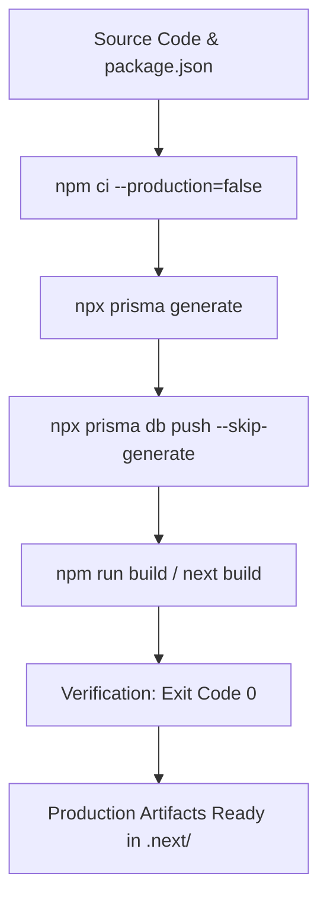

# EHRJ Digital Campus & ERP — Build & Packaging Specification
**Document Version:** 1.0.0  
**Framework:** Next.js 14.2.23 (App Router) + React 18.3.1 + TypeScript 5.7.2  
**ORM / Data Layer:** Prisma ORM 5.22.0 + SQLite 3  

---

## 1. Build Prerequisites

Before executing a build, verify that the host machine satisfies the following verified requirements:

| Component | Minimum Version | Verified In Codebase |
| :--- | :--- | :--- |
| **Node.js** | `v20.17.0+` (LTS) | `Dockerfile` (`FROM node:20-alpine`), `package.json` (`@types/node: ^20.17.10`) |
| **npm** | `v10.x` | Bundled with Node 20 LTS |
| **Operating System** | Linux (Ubuntu 22.04+, Alpine 3.19+) or Windows 10/11 | Verified on Windows & Alpine Linux container |
| **Memory (RAM)** | Minimum 2GB, Recommended 4GB+ | Next.js App Router static optimization builds require ~1.2GB peak memory |
| **Disk Space** | Minimum 3GB free space | `node_modules` (~450MB) + `.next` build cache (~250MB) + Prisma binaries (~100MB) |

---

## 2. Dependency Installation

### 2.1 Standard Installation (CI / Production Host)
Always use `npm ci` rather than `npm install` in automated builds to ensure strict fidelity to `package-lock.json`:

```bash
npm ci --production=false
```

> [!NOTE]
> `--production=false` is mandatory during build because TypeScript, TailwindCSS, PostCSS, and `@types/*` packages reside in `devDependencies` and are required to compile the Next.js bundle.

### 2.2 Alpine Linux Dependency Requirement
Alpine Linux requires `libc6-compat` for compatibility with Prisma query engine binaries and Next.js native SWC bindings:

```bash
apk add --no-cache libc6-compat
```

---

## 3. Step-by-Step Verified Build Process



### Step 1: Generate Prisma ORM Client
Generates the type-safe Prisma client and native query engine binaries matching the local operating system:

```bash
npx prisma generate
```
- **Source:** [`prisma/schema.prisma`](file:///d:/Eliotgonj%20Hazi%20Rohmatollah%20Jamiria%20Madrasha%20Web%20Aplication/prisma/schema.prisma)
- **Target:** `node_modules/@prisma/client`

### Step 2: Synchronize Database Schema (If Not Already Synchronized)
Synchronizes database models directly to the target SQLite database file:

```bash
npx prisma db push
```

> [!CAUTION]
> In production environments with existing operational data, **NEVER** use `--force-reset`. Only run `npx prisma db push` to add new models, columns, and indexes idempotently.

### Step 3: Compile Next.js Production Bundle
Compiles React Server Components, Client Components, Server Actions, API routes, and optimizes static pages:

```bash
npm run build
```

This triggers `next build`, performing:
1. TypeScript static type-checking (`tsconfig.json`).
2. CSS bundling and purging via TailwindCSS and PostCSS.
3. Server bundle compilation with instrumentation hook integration (`src/instrumentation.ts`).
4. Static HTML pre-rendering for public routes (`/`, `/about`, `/academic`, `/notices`, `/contact`, `/gallery`, `/downloads`, `/calendar`, `/search`, etc.).
5. Dynamic route manifest generation for authentication, admin ERP, teacher workplace, guardian portal, and verification endpoints.

---

## 4. Generated Build Artifacts

Upon a successful build (exit code `0`), the following directories and artifacts are generated:

| Artifact Path | Classification | Purpose |
| :--- | :--- | :--- |
| `.next/BUILD_ID` | Text File | Unique hash identifying the compiled build version. |
| `.next/server/` | Server Code | Node.js bundles for Server Components, API routes, middleware, and SSR pages. |
| `.next/static/` | Static Assets | JavaScript chunks, CSS stylesheets, media files served directly to browsers. |
| `.next/prerender-manifest.json` | Manifest | List of pre-rendered static routes and dynamic revalidation settings. |
| `.next/routes-manifest.json` | Manifest | HTTP headers, rewrites, and redirects defined in `next.config.js`. |
| `public/` | Public Root | Favicon, logos (`/images/logo.jpg`), PWA service worker (`/sw.js`), and `manifest.json`. |

---

## 5. Platform-Specific Build Guidelines

### 5.1 Docker Container Build (Verified Multi-Stage)
The project includes a production-ready, multi-stage Dockerfile at [`Dockerfile`](file:///d:/Eliotgonj%20Hazi%20Rohmatollah%20Jamiria%20Madrasha%20Web%20Aplication/Dockerfile):

```bash
# Build production Docker image
docker build -t ehrj-madrasha-app:latest .

# Build with custom public domain argument if required
docker build --build-arg NEXT_PUBLIC_APP_URL="https://www.ehrjmadrasha.com" -t ehrj-madrasha-app:latest .
```

### 5.2 Windows Development Build
- Ensure PowerShell execution policy allows local scripts: `Set-ExecutionPolicy -Scope CurrentUser RemoteSigned`
- Long path support in Windows registry should be enabled if `node_modules` nesting causes path errors.
- Run `npm run build` directly from PowerShell.

---

## 6. Build Validation Criteria

A build is considered production-ready **ONLY** when:
1. `npm run build` exits with code **`0`**.
2. No TypeScript compiler errors are emitted.
3. No missing module resolution errors occur.
4. `.next/BUILD_ID` exists and is non-empty.
5. All 70+ API endpoints and 40+ page routes compile without fatal static evaluation errors.
