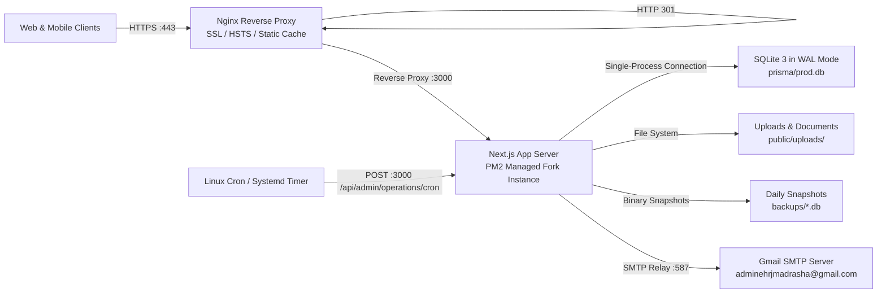

# EHRJ Digital Campus & ERP — Deployment Architecture & Operations
**Document Version:** 1.0.0  
**Target Domain:** `https://www.ehrjmadrasha.com` (with automatic redirect from apex `https://ehrjmadrasha.com` and HTTP)  
**Process Model:** Single-Node Node.js 20 LTS + PM2 Fork Mode + Nginx TLS 1.3 Reverse Proxy  

---

## 1. Actual Deployment Architecture



### 1.1 Concurrency & Persistence Invariant
> [!CRITICAL]
> **Single Process Model Mandatory for SQLite:**  
> The production database is SQLite (`prisma/prod.db` or `/app/data/prod.db`) operating with Write-Ahead Logging (`PRAGMA journal_mode = WAL;`) and busy timeout of 5000ms (`PRAGMA busy_timeout = 5000;`).  
> PM2 **MUST** run in `exec_mode: "fork"` with `instances: 1`.  
> **NEVER** configure PM2 cluster mode (`instances: "max"` or `exec_mode: "cluster"`) while using SQLite datasource; multiple OS processes concurrently writing to an SQLite file will cause database locks (`SQLITE_BUSY`) and process crashes.

---

## 2. Deployment Prerequisites

On the target production VPS (Ubuntu 22.04 LTS or 24.04 LTS):

1. **System Packages:**
   ```bash
   sudo apt update && sudo apt upgrade -y
   curl -fsSL https://deb.nodesource.com/setup_20.x | sudo -E bash -
   sudo apt install -y nodejs nginx git certbot python3-certbot-nginx
   sudo npm install -g pm2
   ```
2. **System User & Permissions:**
   Ensure non-root deployer user has read/write permissions on application directories:
   ```bash
   sudo mkdir -p /var/www/ehrj-app /var/log/ehrj
   sudo chown -R $USER:$USER /var/www/ehrj-app /var/log/ehrj
   ```
3. **DNS Configuration:**
   - **Type A Record:** `@` -> `YOUR_SERVER_PUBLIC_IP`
   - **Type CNAME Record:** `www` -> `ehrjmadrasha.com` (or `@`)

---

## 3. Verified Host Deployment Procedure (Step-by-Step)

### Step 1: Deploy Source Code
Clone or sync the repository into `/var/www/ehrj-app`:
```bash
cd /var/www/ehrj-app
git clone <REPOSITORY_URL> .
# Or pull latest release:
git fetch --all && git checkout main && git pull origin main
```

### Step 2: Configure Environment Variables
Copy and populate production environment variables:
```bash
cp deployment/production.env.example .env
nano .env
```
Ensure the following required values are populated:
```ini
NODE_ENV=production
PORT=3000
APP_URL=https://www.ehrjmadrasha.com
NEXT_PUBLIC_APP_URL=https://www.ehrjmadrasha.com
DATABASE_URL="file:./prisma/prod.db"
# Cryptographic secret (must be unique and >= 32 characters)
JWT_SECRET=your_super_strong_64_character_hex_random_key_here
CRON_SECRET=your_unique_cron_bearer_token_here
WEBHOOK_SIGNING_SECRET=your_unique_webhook_hmac_secret_here
SMTP_HOST=smtp.gmail.com
SMTP_PORT=587
SMTP_USER=adminehrjmadrasha@gmail.com
SMTP_PASS=your_app_specific_gmail_password
```

### Step 3: Install Dependencies & Build Application
```bash
# Clean deterministic install
npm ci --production=false

# Generate Prisma Client & Sync Database
npx prisma generate
npx prisma db push

# Initial setup only: seed baseline administrative and academic accounts
# (Only if setting up fresh database for the first time)
node prisma/seed.js

# Compile Next.js production bundle
npm run build
```

### Step 4: Configure Nginx Reverse Proxy & SSL
Copy the verified Nginx configuration from [`deployment/nginx.conf`](file:///d:/Eliotgonj%20Hazi%20Rohmatollah%20Jamiria%20Madrasha%20Web%20Aplication/deployment/nginx.conf):
```bash
sudo cp deployment/nginx.conf /etc/nginx/sites-available/ehrj-app
sudo ln -sf /etc/nginx/sites-available/ehrj-app /etc/nginx/sites-enabled/
sudo rm -f /etc/nginx/sites-enabled/default
sudo nginx -t
sudo systemctl reload nginx
```

Obtain Let's Encrypt SSL certificates (if setting up for the first time):
```bash
sudo certbot --nginx -d ehrjmadrasha.com -d www.ehrjmadrasha.com --non-interactive --agree-tos -m adminehrjmadrasha@gmail.com
```

### Step 5: Start & Supervise Application with PM2
Launch using [`deployment/ecosystem.config.js`](file:///d:/Eliotgonj%20Hazi%20Rohmatollah%20Jamiria%20Madrasha%20Web%20Aplication/deployment/ecosystem.config.js):
```bash
pm2 start deployment/ecosystem.config.js
pm2 save
pm2 startup
```

### Step 6: Configure Scheduled Cron Jobs
Add the scheduled maintenance trigger to the crontab:
```bash
crontab -e
```
Add the following line (runs every 15 minutes to process notifications, daily backups, and document expiries):
```text
*/15 * * * * curl -s -X POST -H "Authorization: Bearer <CRON_SECRET>" http://localhost:3000/api/admin/operations/cron -d '{"jobKey":"ALL"}' >> /var/log/ehrj/cron.log 2>&1
```

---

## 4. Alternative: Docker Compose Deployment

If deploying via Docker Compose:
```bash
# Ensure .env file exists with production secrets
docker compose up -d --build
```
- App container: `ehrj-madrasha-app` (Node 20 Alpine)
- Exposed port: `3000`
- Persistent volumes: `ehrj-data` (stores SQLite DB) and `ehrj-backups` (stores backup snapshots)
- Built-in Docker healthcheck: `wget -qO- http://localhost:3000/api/health`

---

## 5. Post-Deployment Verification & Health Checks

Execute the following verification sequence immediately following any deployment:

1. **Liveness Health Endpoint:**
   ```bash
   curl -i http://localhost:3000/api/health
   # Expected: HTTP 200 OK
   # {"status":"HEALTHY","timestamp":"...","version":"1.0.0","maintenance":{"isActive":false}}
   ```
2. **Deep Component Diagnostics (Requires Admin Session Cookie):**
   ```bash
   curl -i -H "Cookie: auth_session=<TOKEN>" http://localhost:3000/api/admin/operations/health
   ```
   Verifies: `application`, `database`, `storage`, `authentication`, `email`, `notifications`, `payments`, `backgroundJobs`, and `backups`.
3. **Sitemap & Robots Verification:**
   ```bash
   curl -s https://www.ehrjmadrasha.com/robots.txt | grep "sitemap.xml"
   curl -s https://www.ehrjmadrasha.com/sitemap.xml | grep "https://www.ehrjmadrasha.com"
   ```
4. **Public & Portal Route Smoke Tests:**
   Verify HTTP 200 responses on:
   - `https://www.ehrjmadrasha.com/` (Public Homepage)
   - `https://www.ehrjmadrasha.com/admission` (Online Admission Form)
   - `https://www.ehrjmadrasha.com/results` (Examination Results Portal)
   - `https://www.ehrjmadrasha.com/login` (Authentication Gateway)
   - `https://www.ehrjmadrasha.com/portal` (Guardian & Student Portal)

---

## 6. Common Deployment Failure Points & Resolutions

| Failure Symptom | Root Cause | Verified Resolution |
| :--- | :--- | :--- |
| **FATAL: JWT_SECRET must be explicitly set...** | `JWT_SECRET` is unset, < 32 characters, or using repository demo default string in `NODE_ENV=production`. | Generate a 64-character random string (`openssl rand -hex 32`) and populate `JWT_SECRET` in `.env`. |
| **Prisma query engine binary crash on Alpine Linux** | Missing musl/glibc compatibility library in minimal Alpine base image. | Run `apk add --no-cache libc6-compat` prior to `npm ci`. |
| **Database error `SQLITE_BUSY: database is locked`** | Multiple PM2 worker processes configured in cluster mode, or another process locked the DB file. | Set `instances: 1` and `exec_mode: "fork"` in `deployment/ecosystem.config.js`. Do not run simultaneous parallel migration commands. |
| **Permission Denied writing to SQLite or Backups** | The application process user does not own `/var/www/ehrj-app/prisma/` or `/var/www/ehrj-app/backups/`. | Run `sudo chown -R $USER:$USER /var/www/ehrj-app` and verify write permissions. |
| **Inbound payment webhooks failing (HTTP 401)** | `WEBHOOK_SIGNING_SECRET` is missing in production `.env`. | Set `WEBHOOK_SIGNING_SECRET` to match the secret configured in the bKash/Nagad merchant developer portal. |
| **Automated cron jobs failing (HTTP 401)** | `CRON_SECRET` in crontab curl command does not match `CRON_SECRET` in `.env`. | Ensure identical bearer token strings in crontab and `.env`. |
