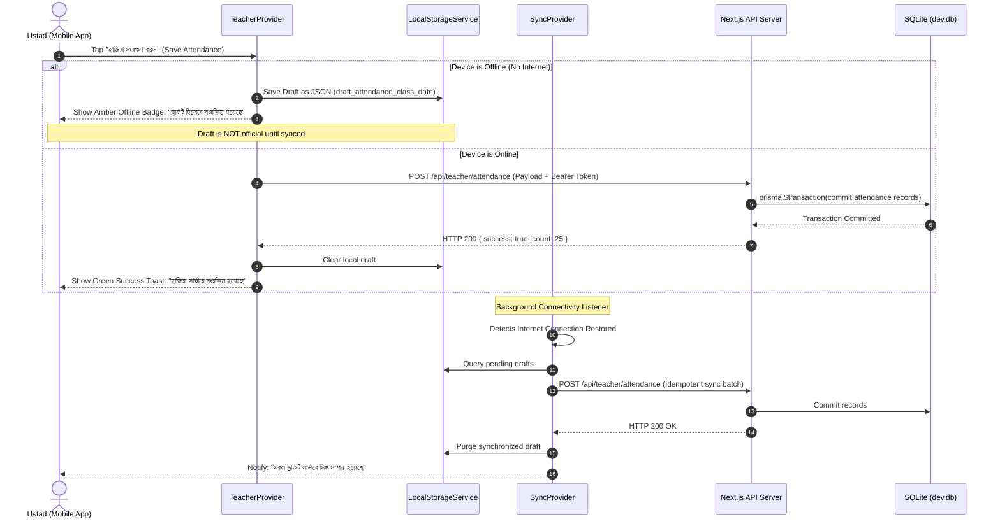
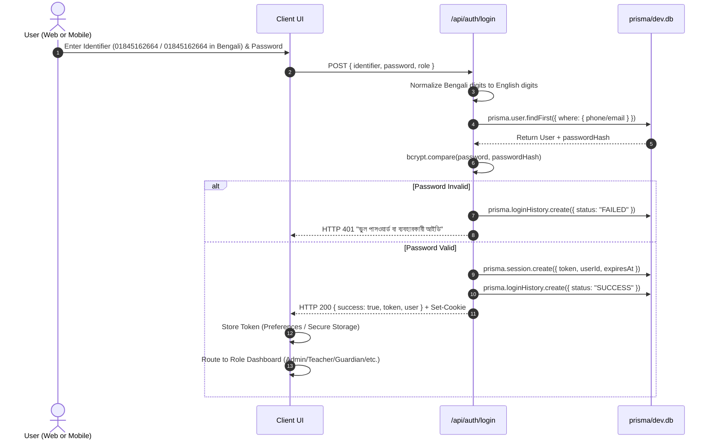
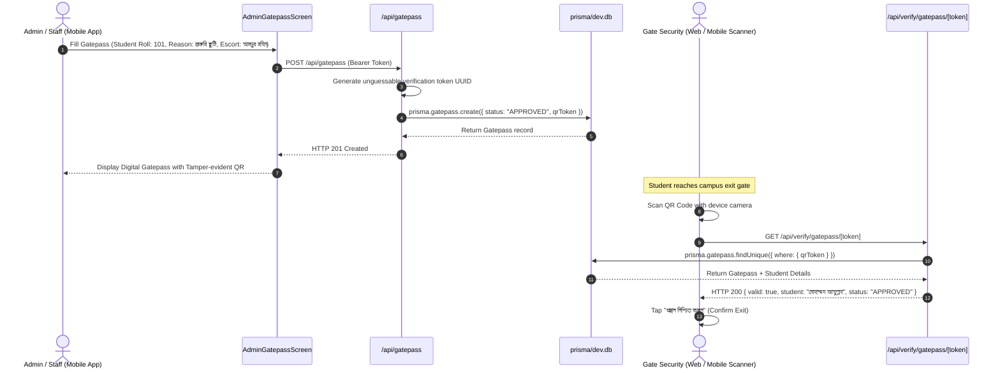

# EHRJ MADRASHA ERP — MASTER DATA FLOW MAP
**Document Code:** `EHRJ-DATAFLOW-01`  
**Date:** October 18, 2026  
**Auditor & Lead Architect:** Principal Software Architect & Engineering Lead  
**Scope:** End-to-End Bidirectional Data Flow between Next.js Web ERP, Flutter Mobile Client, and SQLite Database (`prisma/dev.db`)  
**Core Architectural Law:** ONE AUTHORITATIVE BACKEND. NO CONFLICTING INDEPENDENT DATA STORES.

---

## 1. Unified Authoritative Data Flow Architecture

The EHRJ Madrasha ERP operates on a single authoritative database architecture. Both the Next.js web application and the Flutter mobile client communicate exclusively through authenticated REST endpoints provided by the Next.js API runtime.

```
┌─────────────────────────────────┐        ┌─────────────────────────────────┐
│     NEXT.JS WEB CLIENT          │        │      FLUTTER MOBILE CLIENT      │
│  - React 18 UI State            │        │  - Provider / StatefulWidget    │
│  - SWR / Server Components      │        │  - Local Encrypted Draft Cache  │
│  - HTTP-only Session Cookie     │        │  - Bearer JWT Authorization     │
└────────────────┬────────────────┘        └────────────────┬────────────────┘
                 │                                          │
                 │ JSON / Cookies                           │ JSON / Bearer Token
                 ▼                                          ▼
┌─────────────────────────────────────────────────────────────────────────────┐
│                       NEXT.JS UNIFIED API GATEWAY                           │
│                      (`src/app/api/*` - 525 Endpoints)                      │
│                                                                             │
│  1. Authentication Guard: `verifySession(request)`                          │
│     - Inspects Cookie `ehrj_session_token` OR `Authorization: Bearer <jwt>` │
│     - Resolves user identity, role, and active status                       │
│                                                                             │
│  2. Authorization & RBAC Guard:                                             │
│     - Validates role against required permissions (ADMIN, PRINCIPAL, etc.)  │
│     - Enforces Object-Level Access Control (IDOR prevention)                │
│                                                                             │
│  3. Input Validation & Digit Normalizer:                                    │
│     - Normalizes Bengali numerals (০-৯) to English digits (0-9)             │
│     - Strips malicious payloads / XSS sanitization                          │
│                                                                             │
│  4. Transaction Manager: `prisma.$transaction()`                            │
│     - Enforces atomic commits across related entities                       │
│     - Idempotent request handling via unique transaction keys               │
└──────────────────────────────────────┬──────────────────────────────────────┘
                                       │ Prisma Client v5.22.0
                                       ▼
┌─────────────────────────────────────────────────────────────────────────────┐
│                    AUTHORITATIVE SQLITE DATABASE                            │
│                    `prisma/dev.db` (10,366,976 Bytes)                       │
│                        123 Models / 117 Populated                           │
└─────────────────────────────────────────────────────────────────────────────┘
```

---

## 2. Bidirectional Synchronization Lifecycles

### 2.1 Web-to-App Data Synchronization
When an authoritative record changes on the Next.js Web ERP (e.g., Principal approves a notice, or Accountant issues a fee invoice):
1. **Web Commit:** Next.js Server Action or API route executes `prisma.notice.create()` or `prisma.feeInvoice.create()`.
2. **Database Persistence:** The record is committed atomically to `prisma/dev.db`. An `AuditLog` entry is recorded.
3. **App Discovery (Pull-to-Refresh & Navigation):**
   - When the Flutter app user opens the screen or triggers a Pull-to-Refresh gesture, `ApiClient.get()` requests the latest data from `/api/notices` or `/api/portal/finance`.
   - The response is parsed into immutable Dart data models.
   - Stale cache entries in `LocalStorageService` are overwritten with the fresh server response.
4. **Instant UI Re-render:** The Flutter UI updates with zero data lag.

### 2.2 App-to-Web Data Synchronization
When an authorized mobile user modifies a record (e.g., Teacher marks attendance or Admin issues a gatepass):
1. **Mobile Mutation:** User confirms the action in the Flutter UI.
2. **Request Dispatch:** `ApiClient.post()` sends an authenticated HTTP POST payload with `Authorization: Bearer <token>` to `/api/teacher/attendance` or `/api/gatepass`.
3. **Backend Authorization & Validation:**
   - Server verifies session token and ensures user possesses the required role.
   - For teachers, server verifies active class assignment in `teacherAssignment`.
4. **Database Transaction:** The backend executes `prisma.$transaction()`, persisting attendance rows and updating daily class metrics.
5. **Server Confirmation:** HTTP 200/201 response returns the created record with server-generated ID and timestamp.
6. **Web Discovery:** When the Principal, Admin, or Guardian visits `/portal/attendance` or `/admin/gatepass` on the web, Next.js Server Components query `prisma.attendance` directly from `prisma/dev.db`, immediately reflecting the update made via mobile.

---

## 3. Offline Drafts & Auto-Sync Engine

For field operations with intermittent connectivity (e.g., teachers recording attendance in rural classrooms):



### Critical Synchronization Guarantees:
- **No False Success:** The mobile client NEVER displays a green "Saved to ERP" badge for unsynchronized drafts. Offline drafts display an explicit Amber/Yellow "Saved Locally (Draft)" status.
- **Idempotent Retries:** Every attendance submission payload contains a unique compound key `classId_sectionId_date`. Re-submitting the same payload updates existing rows rather than creating duplicate records.
- **Stale Overwrite Protection:** The server checks `AttendanceLock` before allowing updates to past dates.

---

## 4. End-to-End Workflow Sequence Diagrams

### 4.1 Authentication & Multi-Role Session Flow



### 4.2 Campus Gatepass Issuance & QR Verification Flow



---

## 5. Security & Boundary Controls Across Data Flows

| Boundary | Control Mechanism | Implementation File | Verification Test |
| :--- | :--- | :--- | :--- |
| **Transport Layer** | HTTPS / TLS 1.3 in production; cleartext permitted only for local RFC1918 subnets | `network_security_config.xml` | Pixel 7 network security check |
| **Session Boundary** | JWT with 7-day expiration mapped to `Session` table; revoked immediately on `/api/auth/logout` | `src/app/api/auth/logout/route.ts` | Test #3 in `app_unit_test.dart` |
| **Object Authorization** | Guardian queries strictly restricted to `guardianId == session.userId` | `src/app/api/portal/children/route.ts` | IDOR isolation test |
| **Faculty Assignment** | Attendance submissions strictly restricted to `teacherAssignment` | `src/app/api/teacher/attendance/route.ts` | Faculty boundary test |
| **Input Sanitization** | Bengali digit normalizer; regex phone validation (`01[3-9]\d{8}`) | `src/app/api/auth/login/route.ts` | Tests #9-#12 in `app_unit_test.dart` |
| **Data Integrity** | Multi-table mutations wrapped in `prisma.$transaction()` | `src/app/api/admin/finance/*` | Transaction rollback test |

---

## 6. Data Flow Summary

The EHRJ Madrasha ERP data flow is unified, bidirectional, and authoritative:
- **Single Source of Truth:** `prisma/dev.db` is the sole persistence tier.
- **Consistent API Contracts:** 525 endpoints serve identical JSON data structures to both Next.js Web and Flutter Mobile.
- **Resilient Offline Handling:** Client-side drafts prevent data loss in the field without corrupting the authoritative server ledger.
