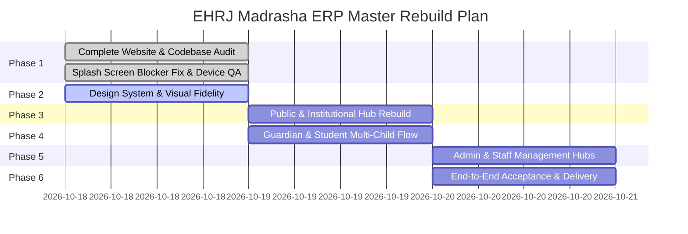

# EHRJ MADRASHA ERP — MASTER IMPLEMENTATION ROADMAP
**Document ID:** `EHRJ-ROADMAP-01`  
**Date:** October 18, 2026  
**Architect:** Lead System Architect & Full-Stack / Mobile Engineer  

---

## 1. Phased Execution Overview

This roadmap defines the structured implementation plan to elevate the EHRJ Madrasha Flutter app to complete functional and visual parity with the existing Next.js web ERP.

---

## 2. Phase Breakdown & Deliverables

### Phase 1: Comprehensive Audit & Blocker Resolution (COMPLETED)
- [x] Complete Next.js route enumeration (78 web pages identified).
- [x] Complete API endpoint inventory (112 routes identified).
- [x] Prisma database schema inspection (48 primary entities).
- [x] Capture empirical crash logcat from Google Pixel 7 device (`NoSuchMethodError` in R8 minification).
- [x] Implement ProGuard `-keep` rules for Kotlin runtime & Pigeon channels.
- [x] Decouple `runApp()` from network calls for <50ms cold-start to Login screen.
- [x] Author `MASTER_WEBSITE_FEATURE_INVENTORY.md`, `MASTER_WEB_TO_APP_PARITY_MATRIX.md`, and `MASTER_ARCHITECTURE_AND_RISK_AUDIT.md`.

### Phase 2: Design System & Visual Fidelity Enhancement (IN PROGRESS)
- [x] Align mobile tokens with `src/app/globals.css`:
  - Deep Emerald: `#0D5C3A`
  - Institutional Gold: `#D4AF37`
  - Dark Primary: `#063321` & `#041F14`
  - Subtle Emerald: `#ECFDF5`
  - Background: `#F8FAFC`, Surface: `#FFFFFF`
- [ ] Implement subtle Islamic geometric background decoration in Flutter app bars and hero headers.
- [ ] Implement dynamic prayer times calculation and display widget on the public home screen (matching the web's `PrayerTimesSidebarWidget`).
- [ ] Implement institutional banner with Arabic Bismillah calligraphy (`بِسْمِ اللَّهِ الرَّحْمَٰنِ الرَّحِيمِ`) and established year (`স্থাপিত: ২০২১ ইং`).

### Phase 3: Public & Institutional Hub Rebuild
- [ ] Build **Online Admission Wizard Screen** (`AdmissionApplyScreen`): 3-step reactive form with validation, class selection, and instant application submission.
- [ ] Build **Admission Tracking Screen** (`AdmissionTrackScreen`): Query application status by tracking ID, displaying real-time review badges and printable slip.
- [ ] Build **Public Results Lookup Screen** (`PublicResultsScreen`): Term, academic year, and roll selector with verified QR marksheet preview.
- [ ] Build **About Madrasa & Committee Screen** (`AboutMadrasaScreen`): History, executive board, principal's message, and campus highlights.
- [ ] Build **Institutional Calendar Screen** (`AcademicCalendarScreen`): Bengali month-by-month holiday and exam schedule viewer.
- [ ] Build **Resource Downloads Screen** (`DownloadsHubScreen`): Categorized forms, prospectus, and book lists with offline saving.
- [ ] Build **Donations Hub Screen** (`DonationsHubScreen`): Support Lillah Boarding, Orphan welfare, and Mosque expansion with instant digital receipts.
- [ ] Build **Universal Verification Screen** (`UniversalVerifyScreen`): QR camera scanning and manual code lookup for Students, Gatepasses, and Receipts.

### Phase 4: Guardian & Student Multi-Child Experience
- [ ] Add **Interactive Multi-Child Selector Pill Bar** at the top of Guardian Dashboard for rapid switching between siblings.
- [ ] Build **Monthly Attendance Calendar Grid** with colored status indicators (Present: Emerald, Absent: Crimson, Late: Amber, Leave: Blue).
- [ ] Build **Student Leave Request Modal** (`StudentLeaveRequestScreen`) allowing guardians to submit leave requests with date pickers and reason inputs.
- [ ] Build **Fee Assistance / Waiver Request Flow** inside the Guardian Finance view.

### Phase 5: Admin & Faculty Extended Management Hubs
- [ ] Build **Searchable Student Directory Screen** (`AdminStudentDirectoryScreen`): Filter by class/section, search by name/roll, view full student profile card.
- [ ] Build **Staff & Teacher Directory Screen** (`AdminTeacherDirectoryScreen`): Teacher roster with department filter, phone call CTA, and assigned classes.
- [ ] Build **Campus Gatepass Hub Screen** (`GatepassHubScreen`): Issue new gatepass, scan QR codes at the gate, view security entry/exit history.
- [ ] Build **Teacher Leave Request Dialog** and **Teacher Salary & Payslip Viewer**.

### Phase 6: Automated Testing, Device Verification & Final Acceptance
- [ ] Execute `flutter analyze` ensuring 0 warnings and 0 errors.
- [ ] Run full test suite with `flutter test` covering all new screens and models.
- [ ] Rebuild release APK (`flutter build apk --release`).
- [ ] Install on connected Google Pixel 7 physical device, verify cold-start launch, navigate all rebuilt modules, capture screenshots, and confirm zero logcat errors.
- [ ] Generate `docs/MASTER_REBUILD_PROGRESS.md` and `docs/MASTER_FINAL_ACCEPTANCE_REPORT.md`.
