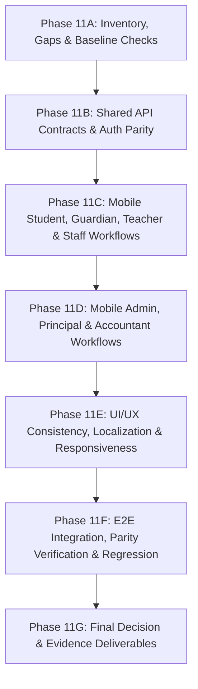

# EHRJ MADRASHA ERP — PHASE 11 IMPLEMENTATION PLAN
## COMPLETE WEB APP + MOBILE APP FEATURE PARITY IMPLEMENTATION

**Document ID:** `EHRJ-PLAN-PHASE-11`  
**Date:** October 20, 2026  
**Auditor & Implementation Lead:** Principal Full-Stack & Mobile Engineer  
**Status:** ACTIVE IMPLEMENTATION  

---

## 1. Executive Objective

Transform the Eliotganj Hazi Rohmatollah Jamiria Madrasha ERP into a unified, production-ready digital campus ecosystem:
1. **Web Platform:** Full interactive responsive web application suite (`/app`) plus public portal, with real-time prayer schedule, instant fee receipts, online result search, teacher attendance matrix, and persona switching.
2. **Mobile Application (`ehrj_flutter_app`):** High-fidelity Flutter app with complete role-based workflows for Admin, Principal, Teacher, Student, Guardian, Accountant, and Public Visitors.
3. **One Authoritative Backend & Database:** Common API contracts between Web and Flutter, guaranteed single source of truth, two-way data persistence, and zero-fallback safety.
4. **Offline Durability & Sync:** Resilient offline queueing for teacher attendance drafts, marks entry, and public offline support without risking financial integrity.
5. **Security, Privacy & Localization:** Server-side RBAC, IDOR protection, guardian-to-child data isolation, and professional Bengali UI/UX.

---

## 2. Implementation Subphases & Scope

### Phase 11A: Repository Inventory, Gap Matrix & Baseline Verification
- Audit existing Next.js web application and Prisma schema (123 models).
- Audit Flutter mobile project (`ehrj_flutter_app`) structure and dependencies.
- Verify baseline compilation: `npx tsc --noEmit` (0 errors), `flutter test` (32 passing), `flutter analyze` (0 issues).
- Maintain absolute database isolation: Port 3000 SQLite master (`prisma/dev.db`) intact, Port 3001 PostgreSQL staging isolated.

### Phase 11B: Shared API Contracts & Two-Way Sync
- Validate `/api/auth/login`, `/api/auth/me`, and session lifecycle across both Web and Flutter.
- Verify token storage, `Authorization: Bearer <token>` injection on Flutter, and HttpOnly session cookie on Web.
- Validate common write APIs:
  - Teacher Attendance: `POST /api/teacher/attendance`
  - Exam Marks: `POST /api/teacher/exams`
  - Gatepass Generation: `POST /api/admin/gatepass`
  - Fee Receipt & Collection: `POST /api/admin/finance/collect-direct` and `POST /api/app/quick-action`
  - Admission Applications: `POST /api/admission/apply` and `POST /api/app/quick-action`

### Phase 11C: Mobile Workflows (Student, Guardian, Teacher, Staff)
- **Student Dashboard:** Personal profile, biometric attendance history, weekly period routine, exam tabulation report card, verified ID card preview with QR.
- **Guardian Dashboard:** Multi-child switcher, children's attendance breakdown, fee status, fee receipts with QR, student leave application.
- **Teacher Dashboard:** Class roster lookup, daily attendance matrix with offline draft save, exam marks entry with boundary checks, assigned class routines, leave request submission.

### Phase 11D: Mobile Workflows (Admin, Principal, Accountant)
- **Admin Dashboard:** Real-time campus statistics, student directory search, teacher & staff roster with direct dial, gatepass issuance modal.
- **Principal Dashboard:** High-level institutional KPIs, fee waiver approvals, teacher leave approvals, notice authorization.
- **Accountant Dashboard:** Instant fee collection, daily cashbook fund balances (General, Lillah, Mosque funds), voucher list.

### Phase 11E: UX Consistency, Responsiveness & Localization
- Ensure consistent color tokens across Web and Flutter (`#041F14` Deep Emerald, `#0D5C3A` Primary Green, `#D4AF37` Gold).
- Responsive layouts across mobile viewports (375px, 390px, 412px) and desktop browsers.
- Native Bengali font typography (Hind Siliguri / Noto Serif Bengali), English data identifiers (`EHRJ-2026-xxxxxx`), and Arabic Quranic titles.

### Phase 11F: Comprehensive Regression & Acceptance Tests
- Two-way persistence test: Mutation via Web -> Read on Flutter API; Mutation via Flutter -> Read on Web.
- IDOR security test: Guardian A cannot access Guardian B's child data.
- Duplicate transaction replay prevention: @unique transaction IDs and idempotency tokens.
- Offline queue sync behavior: Offline draft -> Server reconnection -> Idempotent flush.

### Phase 11G: Documentation & Final Evidence Audit
- Produce `docs/PHASE_11_IMPLEMENTATION_PROGRESS.md`
- Produce `docs/PHASE_11_TEST_RESULTS.md`
- Update `docs/MASTER_WEB_TO_APP_PARITY_MATRIX.md`
- Update `docs/PRODUCTION_GO_NO_GO_DECISION.md`

---

## 3. Strict Safety & Invariants
- **ZERO PRODUCTION DESTRUCTION:** Do not modify, truncate, or overwrite `prisma/dev.db` or golden backups.
- **ZERO LIVE SERVICE ACTIVATION:** No real SMS gateway, live payment merchant charges, or production domain DNS changes.
- **TRUTH-IN-ENGINEERING:** Explicitly tag all automated results (E2E Web Browser, Playwright, Flutter Unit/Integration, Pixel 7 Hardware).
