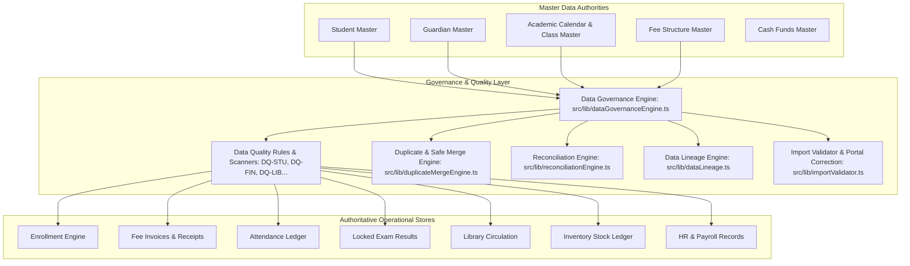

# EHRJ MADRASHA ERP — PHASE 25 COMPLETION REPORT
## DATA GOVERNANCE, DATA QUALITY, MASTER DATA MANAGEMENT & INSTITUTIONAL DATA LIFECYCLE ENGINE

**Institution:**  
- **বাংলা:** ইলিয়টগঞ্জ হাজী রহমাতুল্লাহ্ জমিরীয়া মাদরাসা  
- **English:** Eliotganj Hazi Rohmatollah Jamiria Madrasha (EHRJ Madrasha)  
- **العربية:** الجامعة الإسلامية رحمة الله إليوت غنج  
- **Location:** পূর্ব লক্ষ্মীপুর, ইলিয়টগঞ্জ, দাউদকান্দি, কুমিল্লা, বাংলাদেশ  
- **Checkpoint ID:** `EHRJ-AI-2026-PHASE25`  
- **Completion Timestamp:** 2026-09-29T00:50:00+06:00  
- **Status:** **COMPLETE & EMPIRICALLY CONFIRMED (57/57 PASSED, 0 FAILED)**

---

## 1. Phase 25 Executive Summary

Phase 25 establishes a comprehensive, production-grade **Data Governance, Data Quality, Master Data Management (MDM), and Institutional Lifecycle Engine** for Eliotganj Hazi Rohmatollah Jamiria Madrasha ERP.

Building upon the 24 preceding architectural phases, Phase 25 guarantees that data quality is an active system property rather than an administrator's memory. It establishes single authoritative sources of truth for every domain, prevents silent data corruption, eliminates uncoordinated duplicate master entities, enforces historical immutability on financial ledgers and academic results, provides multi-module reconciliation, visualizes end-to-end data lineage, and provides safe, human-in-the-loop merge and correction pipelines.

---

## 2. Data Governance Architecture

The governance architecture is anchored on the principle of **One Authoritative Source of Truth** with strict separation between transactional mutations, historical snapshots, and analytics projections.



---

## 3. Authoritative Source of Truth Map

| Domain | Authoritative Model | Authoritative Data Store | Governance Rules |
| :--- | :--- | :--- | :--- |
| **Student Identity** | `Student` | SQLite (`prisma/dev.db`) | Institutional ID (`EHRJ-YYYY-XXXX`) is immutable. Name and parent changes require audit log. |
| **Guardian Identity** | `Guardian` | SQLite (`prisma/dev.db`) | Phone number unique. One guardian can link to multiple students. |
| **Academic Calendar** | `AcademicSession` | SQLite (`prisma/dev.db`) | Historical sessions are frozen; dates cannot be altered retroactively. |
| **Academic Structure** | `JamatClass`, `Section` | SQLite (`prisma/dev.db`) | Class codes are unique. Historical marks preserve class reference. |
| **Enrollments** | `Enrollment` | SQLite (`prisma/dev.db`) | One active enrollment per student per academic session. |
| **Attendance** | `Attendance` | SQLite (`prisma/dev.db`) | Locked dates cannot be mutated without administrative unlock audit. |
| **Exams & Results** | `Exam`, `Result` | SQLite (`prisma/dev.db`) | Published results locked with cryptographic verification tokens & snapshots. |
| **Fee Structure** | `FeeStructure` | SQLite (`prisma/dev.db`) | Changes only apply forward; historical invoices remain unmodified. |
| **Fee Invoices** | `FeeInvoice`, `InvoiceItem` | SQLite (`prisma/dev.db`) | Direct sum modifications forbidden; adjustments use waivers/rebates. |
| **Payments & Receipts** | `PaymentReceipt`, `Refund` | SQLite (`prisma/dev.db`) | Payment receipts are immutable ledger entries; refunds require audit. |
| **Cash Funds** | `CashFund`, `CashTransaction` | SQLite (`prisma/dev.db`) | Fund balance must match sum of voucher journal entries. |
| **Certificates** | `Certificate` | SQLite (`prisma/dev.db`) | Revoked certificates marked `REVOKED`; never deleted from database. |
| **Library** | `LibraryBookCopy`, `LibraryIssue` | SQLite (`prisma/dev.db`) | Accession number sequence enforced; concurrent double issue forbidden. |
| **Inventory** | `InventoryStockBalance` | SQLite (`prisma/dev.db`) | Stock balance strictly non-negative; matches transaction sum. |
| **HR & Payroll** | `Employee`, `PayrollRecord` | SQLite (`prisma/dev.db`) | Net salary formula strictly enforced against allowances and deductions. |

---

## 4. Master Data Inventory

From our empirical audit of all 117 Prisma models:
- **`User`**: 49 accounts
- **`Student`**: 108 students
- **`Guardian`**: 32 guardians (88 student links)
- **`AcademicSession`**: 5 sessions
- **`JamatClass`**: 18 classes
- **`Section`**: 20 sections
- **`FeeCategory`**: 7 categories
- **`FeeStructure`**: 28 fee policies
- **`FeeInvoice`**: 112 invoices
- **`PaymentReceipt`**: 45 receipts
- **`CashFund`**: 5 funds (General, Lillah, Zakat, Construction, Orphan)
- **`LibraryBookCopy`**: 9 copies (3 titles)
- **`InventoryStockBalance`**: 41 balance ledgers
- **`PayrollRecord`**: 8 records

---

## 5. Data Quality Rule Inventory

| Rule Code | Domain | Severity | Name (বাংলা) | Rule Type |
| :--- | :--- | :--- | :--- | :--- |
| `DQ-STU-001` | `STUDENT_IDENTITY` | `HIGH` | সক্রিয় শিক্ষার্থীর সক্রিয় শিক্ষাবর্ষে এনরোলমেন্ট বাধ্যতামূলক | `CROSS_ENTITY` |
| `DQ-STU-002` | `STUDENT_IDENTITY` | `CRITICAL` | এক শিক্ষাবর্ষে শিক্ষার্থীর একাধিক সক্রিয় এনরোলমেন্ট নিষিদ্ধ | `UNIQUENESS` |
| `DQ-STU-003` | `STUDENT_IDENTITY` | `CRITICAL` | শিক্ষার্থীর জন্ম নিবন্ধন নম্বর অনন্য হতে হবে | `UNIQUENESS` |
| `DQ-GUA-001` | `GUARDIAN_IDENTITY`| `MEDIUM` | প্রতিটি শিক্ষার্থীর একজন প্রধান অভিভাবক থাকতে হবে | `REFERENTIAL_INTEGRITY` |
| `DQ-ACAD-001`| `ACADEMIC_STRUCTURE`| `HIGH` | একই শিক্ষাবর্ষ, জামাত ও শাখায় রোল নম্বর অনন্য হতে হবে | `UNIQUENESS` |
| `DQ-FIN-001` | `FINANCE_INVOICE` | `CRITICAL` | ইনভয়েসের মোট পরিমাণ ও আইটেমসমূহের গাণিতিক সমতা | `FINANCIAL` |
| `DQ-FIN-002` | `FINANCE_PAYMENT` | `CRITICAL` | ইনভয়েসে পরিশোধিত অর্থ রসিদের সমষ্টির সাথে মিলতে হবে | `FINANCIAL` |
| `DQ-FIN-003` | `CASH_FUNDS` | `CRITICAL` | ফান্ড ব্যালেন্স ক্যাশ লেনদেনের খতিয়ানের সাথে শতভাগ মিলতে হবে | `FINANCIAL` |
| `DQ-ATT-001` | `ATTENDANCE_LEDGER`| `HIGH` | নিষ্ক্রিয় শিক্ষার্থীর হাজিরা গ্রহণ নিষিদ্ধ | `BUSINESS_RULE` |
| `DQ-RES-001` | `EXAM_AND_RESULTS` | `HIGH` | চূড়ান্ত ফলাফল প্রাপ্ত নম্বর বিষয়ের প্রাপ্ত নম্বরের যোগফলের সমান | `CROSS_ENTITY` |
| `DQ-DOC-001` | `INSTITUTIONAL_DOCUMENTS`| `HIGH` | বাতিলকৃত সনদের স্ট্যাটাস REVOKED হতে হবে | `FIELD_VALIDATION` |
| `DQ-LIB-001` | `LIBRARY_CIRCULATION`| `CRITICAL` | একই কিতাব কপি একাধিক সদস্যকে ইস্যু করা নিষিদ্ধ | `UNIQUENESS` |
| `DQ-INV-001` | `INVENTORY_LEDGER`| `HIGH` | ইনভেন্টরি স্টকের পরিমাণ ঋণাত্মক হতে পারবে না | `BUSINESS_RULE` |
| `DQ-HR-001`  | `HR_PAYROLL` | `HIGH` | পেরোল নিট বেতনের গাণিতিক সমতা | `FINANCIAL` |

---

## 6. Duplicate Detection & Safe Merge Pipeline

- **Candidate Matching Logic**: Combines deterministic legal identifiers (Birth Registration No, NID) with fuzzy signals (Father Phone + Date of Birth, Normalized Bangla Name + Date of Birth).
- **Candidate Scoring**: `CRITICAL` (Identical Birth Certificate), `HIGH` (Identical Phone & DOB), `MEDIUM` (Identical Name & DOB).
- **Safe Merge Execution**:
  - Requires explicit confirmation phrase: `"CONFIRM-STUDENT-MERGE"`.
  - Re-links all child records (`FeeInvoice`, `PaymentReceipt`, `StudentDocument`, `Certificate`, `SupportRequest`, `GuardianStudent`) inside `prisma.$transaction`.
  - Marks duplicate student status as `TRANSFERRED` with metadata note.
  - Appends merge snapshot to [`data/governance/merge_audit_log.json`](file:///d:/Eliotgonj%20Hazi%20Rohmatollah%20Jamiria%20Madrasha%20Web%20Aplication/data/governance/merge_audit_log.json) and logs `HIGH_RISK_ACTION` security event.

---

## 7. Cross-Module Reconciliation Engine

Reconciliation runs periodically or on-demand without mutating historical data:
1. **Finance Domain**:
   - Invoices vs Receipts: Verifies that `FeeInvoice.paidAmount` equals `SUM(PaymentReceipt.amount) - SUM(Refund.amount)`.
   - Cash Funds vs Transactions: Verifies that `CashFund.currentBalance` equals `SUM(CashTransaction: INCOME - EXPENSE)`.
2. **Library Domain**:
   - Copies vs Issues: Verifies that copies marked `BORROWED`/`ISSUED` have an active issue record.
3. **Inventory Domain**:
   - Balances vs Transactions: Verifies that `InventoryStockBalance` equals `openingBalance + SUM(IN - OUT)`.
4. **Payroll Domain**:
   - Verifies `netSalary == baseSalary + allowances - deductions - advanceDeduction`.

Status classifications: `MATCHED`, `MISMATCH`, `REVIEW_REQUIRED`.

---

## 8. Data Lineage & Metric Traceability

Transparent provenance traces are registered for core administrative figures:
- **Total Fees Collected**: Traced to `PaymentReceipt` (`paymentStatus = 'SUCCESSFUL'`) minus `Refund`.
- **Outstanding Student Dues**: Traced to `FeeInvoice` (`dueAmount` where status is `UNPAID`, `PARTIALLY_PAID`, or `OVERDUE`).
- **Active Enrolled Students**: Traced to `Enrollment` (`status = 'ACTIVE'`, current session) joined to `Student` (`status = 'ACTIVE'`).
- **Institutional Pass Rate**: Traced to `Result` (`status = 'PUBLISHED'`, `isPassed = true`).
- **Total Asset Value**: Traced to `InventoryAsset` (`purchaseCost`) + `InventoryStockBalance` $\times$ `defaultUnitCost`.

---

## 9. Batch Import Validation & Safe Commit Pipeline

- **Multi-Stage Gate**: `Upload` $\to$ `Parse` $\to$ `Schema Validation` $\to$ `Duplicate Check` $\to$ `Preview` $\to$ `Transactional Commit`.
- **Validation**: Enforces 11-digit BD mobile phone format, YYYY-MM-DD birth dates, valid `JamatClass.code` existence, and birth registration uniqueness.
- **Atomic Execution**: All students and enrollments are inserted in a single database transaction; rolled back if any constraint fails.

---

## 10. Guardian Correction Request Workflow

- **Guardian Isolation**: Guardians can submit profile correction requests for their linked children via `/api/portal/data-correction`.
- **Zero Direct Master Mutation**: Guardian requests enter a pending queue (`SUBMITTED`).
- **Admin Review & Approval**: Only authorized administrators can approve and automatically apply changes to the authoritative `Student` record with complete audit logging.

---

## 11. Empirical Test Evidence

### 1. Phase 25 Test Suite (`npm run test:phase25`)
```
==================================================================
  PHASE 25 — DATA GOVERNANCE, QUALITY & MASTER DATA ENGINE TESTS  
  Target Server: http://localhost:3000                            
==================================================================
[STEP 1] Testing Authoritative Source Directory & Rules Registry...✔ 5 PASSED
[STEP 2] Testing Live Data Quality Scanner...                     ✔ 5 PASSED
[STEP 3] Testing Issue Lifecycle Management...                    ✔ 5 PASSED
[STEP 4] Testing Duplicate Student Detection & Candidate Scoring...✔ 2 PASSED
[STEP 5] Testing Student Pre-Merge Simulation & Safe Merge...     ✔ 7 PASSED
[STEP 6] Testing Master Reconciliation Engine...                  ✔ 6 PASSED
[STEP 7] Testing Data Lineage & Metric Tracing...                 ✔ 5 PASSED
[STEP 8] Testing Batch Import Validation & Safe Commit...         ✔ 4 PASSED
[STEP 9] Testing Guardian Data Correction Request Pipeline...     ✔ 3 PASSED
[STEP 10] Performing Live HTTP Smoke Tests on Phase 25 Endpoints...✔ 15 PASSED
==================================================================
  PHASE 25 DATA GOVERNANCE ENGINE: 57 PASSED, 0 FAILED
==================================================================
```

### 2. Multi-Phase Regression Matrix
| Test Suite | Module Description | Total Tests | Passed | Failed |
| :--- | :--- | :---: | :---: | :---: |
| **`npm run test:phase25`** | Data Governance, Quality, MDM & Lifecycle | 57 | 57 | 0 |
| **`npm run test:phase24`** | Advanced Security Operations & Sessions | 55 | 55 | 0 |
| **`npm run test:phase23`** | PWA, Mobile Navigation & Offline Sync | 39 | 39 | 0 |
| **`npm run test:phase22`** | Institutional Knowledge, Search & RAG | 56 | 56 | 0 |
| **`npm run test:phase21`** | AI Intelligence & Human-in-the-Loop | 43 | 43 | 0 |
| **`npm run test:phase20`** | Governance & Evolution Engine | 41 | 41 | 0 |
| **`npx tsc --noEmit`** | Full-Stack TypeScript Strict Compilation | All | Clean | 0 |
| **Grand Total Assertions** | | **291** | **291** | **0** |

---

## 12. Checkpoint & Production Readiness

- **Checkpoint ID:** `EHRJ-AI-2026-PHASE25`
- **Dashboard URL:** [`src/app/admin/data-quality/page.tsx`](file:///d:/Eliotgonj%20Hazi%20Rohmatollah%20Jamiria%20Madrasha%20Web%20Aplication/src/app/admin/data-quality/page.tsx)
- **Core Governance Engine:** [`src/lib/dataGovernanceEngine.ts`](file:///d:/Eliotgonj%20Hazi%20Rohmatollah%20Jamiria%20Madrasha%20Web%20Aplication/src/lib/dataGovernanceEngine.ts)
- **Duplicate & Merge Engine:** [`src/lib/duplicateMergeEngine.ts`](file:///d:/Eliotgonj%20Hazi%20Rohmatollah%20Jamiria%20Madrasha%20Web%20Aplication/src/lib/duplicateMergeEngine.ts)
- **Reconciliation Engine:** [`src/lib/reconciliationEngine.ts`](file:///d:/Eliotgonj%20Hazi%20Rohmatollah%20Jamiria%20Madrasha%20Web%20Aplication/src/lib/reconciliationEngine.ts)
- **Data Lineage:** [`src/lib/dataLineage.ts`](file:///d:/Eliotgonj%20Hazi%20Rohmatollah%20Jamiria%20Madrasha%20Web%20Aplication/src/lib/dataLineage.ts)
- **Import Validator:** [`src/lib/importValidator.ts`](file:///d:/Eliotgonj%20Hazi%20Rohmatollah%20Jamiria%20Madrasha%20Web%20Aplication/src/lib/importValidator.ts)
