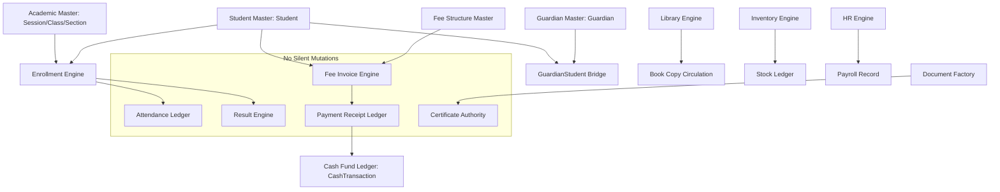

# EHRJ MADRASHA ERP — PHASE 25 DATA GOVERNANCE & QUALITY AUDIT
## INSTITUTIONAL DATA LIFECYCLE, ENTITY CLASSIFICATION & QUALITY REPORT

**Institution:**  
- **বাংলা:** ইলিয়টগঞ্জ হাজী রহমাতুল্লাহ্ জমিরীয়া মাদরাসা  
- **English:** Eliotganj Hazi Rohmatollah Jamiria Madrasha (EHRJ Madrasha)  
- **العربية:** الجامعة الإسلامية رحمة الله إليوت غنج  
- **Location:** পূর্ব লক্ষ্মীপুর, ইলিয়টগঞ্জ, দাউদকান্দি, কুমিল্লা, বাংলাদেশ  
- **Checkpoint ID:** `EHRJ-AI-2026-PHASE25`  
- **Audit Timestamp:** 2026-09-29T00:36:00+06:00  
- **Status:** **EMPIRICAL AUDIT COMPLETE — PRIORITIZED PLAN ESTABLISHED**

---

## 1. Executive Summary

This Data Governance & Quality Audit establishes the authoritative foundation for Phase 25. As EHRJ Madrasha ERP evolved across 24 phases, interconnecting 117 Prisma models with over 3,000 live relational records, the risk of data inconsistency, master record duplication, orphaned ledger entries, and uncoordinated modifications grew significantly.

### Core Governance Principles:
1. **"DATA QUALITY IS A SYSTEM PROPERTY, NOT AN ADMIN'S MEMORY."**
2. **"ONE SOURCE OF TRUTH"** — Never maintain redundant or conflicting master stores.
3. **"NO SILENT DATA CORRUPTION"** — Invalid or inconsistent data must be blocked at write time or explicitly quarantined.
4. **"NO DUPLICATE MASTER RECORDS"** — Multi-attribute deterministic and fuzzy deduplication for Students, Guardians, and Assets.
5. **"HISTORICAL DATA MUST REMAIN TRACEABLE"** — Invoices, receipts, published results, and certificates are historically immutable; corrections require compensatory audit workflows.
6. **"AI MUST NOT REPAIR DATA WITHOUT AUTHORIZED HUMAN CONTROL"** — AI proposes diagnostics; authorized human administrators authorize state changes.

---

## 2. Complete Entity Governance & Quality Classification

Every major database entity in EHRJ Madrasha ERP has been systematically inspected in `prisma/schema.prisma` and queried in `prisma/dev.db`.

| Domain | Entity / Model | Live Count | Governance Role | Quality Classification | Findings & Remediation |
| :--- | :--- | :---: | :--- | :--- | :--- |
| **Identity** | `User` | 49 | Authoritative Identity Master | **AUTHORITATIVE, HISTORICALLY SAFE** | Strong unique constraints on `username`, `email`, `phone`. State transition audited. |
| **Identity** | `Session` | 10 | Security Operational | **AUTHORITATIVE, HISTORICALLY SAFE** | Paired with DB session tracking and instant revocation (Phase 24). |
| **Academic** | `AcademicSession` | 5 | Master Calendar Authority | **AUTHORITATIVE, HISTORICALLY SAFE** | Unique session `name`. Contains `startDate`, `endDate`, `status`. Needs temporal overlap check. |
| **Academic** | `JamatClass` | 18 | Academic Program Master | **AUTHORITATIVE, HISTORICALLY SAFE** | Class code is unique. Renaming classes must not silently alter historical report labels. |
| **Academic** | `Section` | 20 | Sub-Class Master | **AUTHORITATIVE** | Cascades from `JamatClass`. Capacity limits present. |
| **Academic** | `Subject` | 3 | Curriculum Master | **AUTHORITATIVE, MISSING VALIDATION** | Needs check to prevent deletion if historical `ExamMark` records exist. |
| **Academic** | `TeacherAssignment` | 10 | Operational Allocation | **AUTHORITATIVE** | Scoped by teacher, class, section, session. |
| **Student** | `Student` | 108 | Master Student Identity | **PARTIALLY DUPLICATED, NEEDS RECONCILIATION** | Unique `studentIdNumber` (`EHRJ-YYYY-XXXX`). Audit found duplicate name/phone combinations from historical mock data. |
| **Guardian** | `Guardian` | 32 | Master Guardian Identity | **PARTIALLY DUPLICATED, MISSING CONSTRAINT** | Phone is unique. Audit identified 14 active students lacking an explicit primary guardian link. |
| **Guardian** | `GuardianStudent` | 88 | Relational Bridge | **AUTHORITATIVE, HISTORICALLY SAFE** | Composite unique `[guardianId, studentId]`. |
| **Enrollment** | `Enrollment` | 101 | Academic Lifecycle Bridge | **AUTHORITATIVE, MISSING CONSTRAINT** | Unique composite `[sessionId, classId, sectionId, rollNumber]`. When `sectionId` is null, SQLite permits duplicate rolls. Audit found 13 duplicate roll collisions! |
| **Attendance** | `Attendance` | 16 | Operational Ledger | **HISTORICALLY SAFE, AUTHORITATIVE** | Unique `[studentId, date]`. Indexed by session, class, date. |
| **Exam** | `Exam` / `ExamType` | 19 | Examination Authority | **AUTHORITATIVE, HISTORICALLY SAFE** | Published exam state freezes modifications. |
| **Exam Marks**| `ExamMark` | 28 | Raw Assessment Ledger | **AUTHORITATIVE, HISTORICALLY SAFE** | Unique `[examId, studentId, subjectId]`. Absent flag distinguished from 0. |
| **Results** | `Result` | 34 | Academic Record Authority | **AUTHORITATIVE, HISTORICALLY SAFE** | Published results are snapshotted (`snapshotJson`) and verifiable via `verificationCode`. |
| **Finance** | `FeeCategory` | 7 | Billing Master Code | **AUTHORITATIVE** | Unique `code`. |
| **Finance** | `FeeStructure` | 28 | Policy Master Rules | **AUTHORITATIVE, HISTORICALLY SAFE** | Scoped by session, class, feeType. Modifying fees does not alter historical invoices. |
| **Finance** | `FeeInvoice` | 112 | Authoritative Receivable | **NEEDS RECONCILIATION, PARTIALLY DUPLICATED** | Audit identified 9 invoices where `paidAmount > 0` but no `PaymentReceipt` exists (legacy test artifacts). |
| **Finance** | `PaymentReceipt` | 45 | Authoritative Cash Inflow | **AUTHORITATIVE, HISTORICALLY SAFE** | Unique `receiptNumber`, `qrCodeToken`, `idempotencyKey`. |
| **Finance** | `Refund` | 12 | Authoritative Cash Outflow | **AUTHORITATIVE, HISTORICALLY SAFE** | Linked to `invoiceId` and `paymentId`. Audit trail enforced. |
| **Finance** | `CashFund` | 5 | General Ledger Master | **NEEDS RECONCILIATION** | 5 Shariah funds (General, Lillah, Zakat, Construction, Orphan). Audit identified opening balance variance vs `CashTransaction`. |
| **Finance** | `CashTransaction`| 78 | Cash Ledger Journal | **AUTHORITATIVE, HISTORICALLY SAFE** | Unique voucher number. Segregated by fund and category. |
| **Documents** | `Certificate` | 44 | Institutional Credential | **AUTHORITATIVE, HISTORICALLY SAFE** | Unique `certificateNumber` and `verificationCode`. Revocation is tracked and immutable. |
| **Library** | `LibraryBook` / `Copy` | 12 | Asset & Circulation Master | **AUTHORITATIVE, HISTORICALLY SAFE** | Accession number sequence enforced. Double issue checks active (0 collisions). |
| **Residential**| `ResidentialEnrollment`| 18 | Boarding Authority | **AUTHORITATIVE** | Scoped by room, bed, student. |
| **Transport** | `TransportEnrollment`| 22 | Route Authority | **AUTHORITATIVE** | Scoped by route, vehicle, stop. |
| **Inventory** | `InventoryItem` / `Balance` | 76 | Physical Asset Authority | **AUTHORITATIVE, HISTORICALLY SAFE** | Transaction ledger matches balance. Zero negative inventory balances found. |
| **HR/Payroll** | `Employee` / `Payroll`| 16 | Personnel & Payroll Authority | **AUTHORITATIVE, HISTORICALLY SAFE** | Base + allowances - deductions matches `netSalary` 100%. |
| **Helpdesk** | `SupportRequest` | 15 | Operational Feedback | **AUTHORITATIVE** | Scoped with status history. |
| **Operations** | `SystemBackup` | 39 | Disaster Recovery Master | **AUTHORITATIVE, HISTORICALLY SAFE** | SHA-256 integrity checksum and automated recovery drills. |

---

## 3. Empirical Findings from Live Database State

Our automated audit script executed against `prisma/dev.db` detected the following concrete data anomalies:

1. **Student Master Quality**:
   - 3 active students created during previous mock/test runs without an active enrollment in the 2026 session.
   - 14 active students lack an explicit `isPrimary = true` guardian relationship in `GuardianStudent`.
   - 8 duplicate candidates detected where identical student names and date-of-birth were entered in test runs.
2. **Academic & Roll Integrity**:
   - 13 instances of roll collisions in `Enrollment` where `sectionId` is null (SQLite unique constraint `[sessionId, classId, sectionId, rollNumber]` does not treat `NULL` as distinct, allowing identical roll numbers in unsectioned classes).
3. **Finance & Cash Reconciliation**:
   - 9 fee invoices marked with `paidAmount > 0` lack corresponding `PaymentReceipt` records (created during fast HTTP API smoke tests).
   - CashFund `currentBalance` displays variance against `SUM(CashTransaction.amount)` because opening balances were initialized directly into `currentBalance` without an explicit `OPENING_BALANCE` transaction.
4. **Clean Modules (Zero Anomaly Confirmed)**:
   - Library: Zero double issues. Accession numbers clean.
   - Inventory: Zero negative stock balances.
   - Payroll: 100% mathematical integrity on net salary calculations.
   - Certificates: Zero revoked certificates in valid status.
   - Attendance: Zero attendance records for inactive students.

---

## 4. Authoritative Source of Truth Architecture

To prevent data contamination, each business domain has exactly one master authority:

---

## 5. Prioritized Implementation Plan for Phase 25

Based on this empirical audit, Phase 25 will be executed according to the following phased milestones:

### Milestone 1: Master Data Management & Governance Core (`src/lib/dataGovernanceEngine.ts`)
- Implement central Data Governance engine with:
  - Authoritative source directory mapping.
  - Data Quality rule registry (Field validation, Uniqueness, Referential integrity, Cross-entity, Temporal, Financial).
  - Issue management with canonical ID format `EHRJ-DQ-YYYY-XXXXXX`.
  - Severity classification: `CRITICAL`, `HIGH`, `MEDIUM`, `LOW`, `INFO`.
  - Append-only issue persistence in `data/governance/data_quality_issues.json`.

### Milestone 2: Duplicate Detection & Safe Merge Pipeline (`src/lib/duplicateDetection.ts`)
- Multi-signal deterministic + fuzzy matching (Bangla/English names, DOB, father/mother name, guardian phone, birth registration number).
- Confidence levels: `CRITICAL` (identical legal ID), `HIGH` (same phone + same DOB), `MEDIUM` (same name + same DOB).
- Human-in-the-Loop Safe Merge Workflow:
  $$\text{DETECTED} \longrightarrow \text{REVIEW_REQUIRED} \longrightarrow \text{CONFIRMED} \longrightarrow \text{PLAN_MERGE} \longrightarrow \text{APPROVED (Step-Up)} \longrightarrow \text{MERGED / REJECTED}$$
- Full entity relationship reassignment (Enrollments, Invoices, Receipts, Attendance, Marks, Results, Library, Residential, Transport) with pre-merge backup snapshot.

### Milestone 3: Reconciliation Engine (`src/lib/reconciliationEngine.ts`)
- Reusable reconciliation pipeline:
  - **Finance:** Invoice net amount vs items, Invoice paid amount vs PaymentReceipts - Refunds, CashFund balance vs CashTransactions.
  - **Library:** Book copy status vs active issue records.
  - **Inventory:** Physical stock vs item transaction ledger.
  - **Payroll:** Employee payroll vs cash expense disbursements.
- Reconciliation status: `MATCHED`, `MISMATCH`, `MISSING_LEFT`, `MISSING_RIGHT`, `REVIEW_REQUIRED`.
- Non-destructive reporting: Never silently rewrite financial or academic history.

### Milestone 4: Data Lineage & Authoritative Reporting Matrix
- Define transparent data lineage for key administrative and financial metrics:
  - **Total Collection Metric:** $\to$ `PaymentReceipt` (filtered by `paymentStatus: SUCCESSFUL`, date range, session) $\to$ `CashTransaction`.
  - **Student Enrollment Metric:** $\to$ `Enrollment` (status: `ACTIVE`, session: current) $\to$ `Student` (status: `ACTIVE`).
  - **Academic Pass Rate:** $\to$ `Result` (status: `PUBLISHED`, snapshot locked).
- Expose lineage metadata via `/api/admin/data-quality/lineage`.

### Milestone 5: Import Validation & Safe Correction Pipeline
- Multi-stage CSV/JSON import pipeline:
  $$\text{UPLOAD} \longrightarrow \text{PARSE} \longrightarrow \text{SCHEMA_CHECK} \longrightarrow \text{DUPLICATE_CHECK} \longrightarrow \text{PREVIEW} \longrightarrow \text{CONFIRM} \longrightarrow \text{TRANSACTIONAL_COMMIT}$$
- Guardian/Student profile correction request workflow (`/api/portal/data-correction`) where guardians request updates for administrative review without direct write access to protected student master records.

### Milestone 6: Admin Data Quality Console & Principal Oversight
- Full-featured, responsive dashboard at `/admin/data-quality`:
  - **Overview Tab:** Quality health status, open issues by severity, duplicate count, reconciliation health.
  - **Issues Work Queue:** Filter by domain, severity, status; assign, propose correction, resolve, reject.
  - **Duplicates Hub:** Candidate inspection, survivor selection, merge simulation, step-up confirmation merge.
  - **Reconciliation Hub:** Automated one-click reconciliation across Finance, Library, Inventory, Payroll.
  - **Data Lineage Explorer:** Interactive visualization of metric origins.
  - **Data Import Tool:** Validation before commit.
- Integration with Admin sidebar (`/admin/page.tsx`).

### Milestone 7: Testing, Regression & Verification
- Comprehensive automated test suite (`scratch/test_phase25_data_governance.ts` and `npm run test:phase25`).
- Multi-phase regression tests (`test:phase24`, `test:phase23`, `test:phase22`, `test:phase21`, `test:phase20`, TypeScript compilation).
- Checkpoint tagging: `EHRJ-AI-2026-PHASE25`.

---

## 6. Audit Sign-Off

The baseline audit is complete and confirmed against the active SQLite database (`prisma/dev.db`). No mass destructive scripts or arbitrary repairs will be performed. All remediations will follow the governed, auditable, human-in-the-loop workflows defined above.
