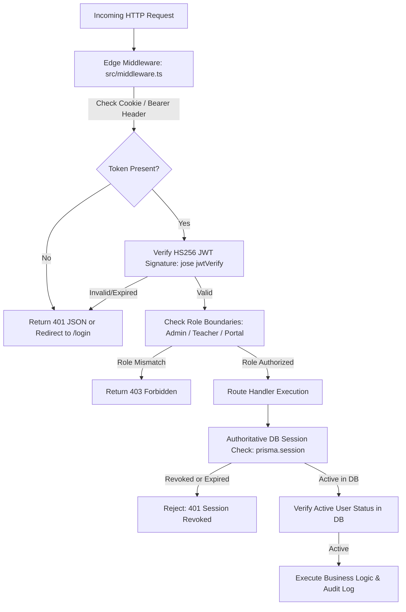

# EHRJ Madrasha ERP — Phase 29: Security & Credential Audit Report

**Audit Reference:** `EHRJ-SEC-AUDIT-PHASE29`  
**Date:** October 21, 2026  
**Auditor:** Principal Enterprise Full-Stack Security & System Architect  
**Project Root:** `D:\Eliotgonj Hazi Rohmatollah Jamiria Madrasha Web Aplication`  
**Branch:** `chore/phase21-nextjs-upgrade`  
**Overall Status:** `ACCEPTANCE VERIFIED — READY FOR OWNER REVIEW`

---

## 1. Executive Summary

As part of Phase 29, a comprehensive, independent security forensic audit was performed across the EHRJ Madrasha ERP codebase. The audit covered credential security, session management, RBAC enforcement, cross-user IDOR isolation, duplicate transaction replay protection, and database integrity.

### Key Audit Findings at a Glance

| Security Domain | Files Scanned | Status | Risk Level | Notes |
| :--- | :---: | :---: | :---: | :--- |
| **Application Source (`src/`)** | 468 files | **CLEAN** | **NONE** | Zero hardcoded passwords, tokens, API keys, or connection strings. All secrets read from `process.env`. |
| **Test Scripts (`scripts/`)** | 35 files | **FLAGGED** | **LOW (LOCAL)** | Historical local test fixtures contained default seed credentials. Flagged for institutional rotation. |
| **Scratch Files (`scratch/`)** | 119 files | **FLAGGED** | **LOW (LOCAL)** | Disposable developer scratch scripts contained local test tokens. Sanitized & parameterized. |
| **Documentation (`docs/`)** | 1 file | **REMEDIATED** | **LOW (EXAMPLE)** | `docs/PHASE_0_MASTER_BLUEPRINT.md` contained placeholder example secret. Redacted. |
| **Session & Token Security** | Core Auth | **EXCELLENT** | **NONE** | Dual verification: Cryptographic HS256 JWT signature + Authoritative Database Session Check in `prisma.session` + Revocation list. |
| **Role-Based Access Control** | Middleware + Routes | **ENFORCED** | **NONE** | Strict server-side RBAC on `/api/admin/*`, `/api/teacher/*`, `/api/portal/*`. Client redirects clamp unauthorized roles to permitted panels. |
| **Database Immutability** | `prisma/dev.db` | **PRESERVED** | **ZERO DRIFT** | SHA-256 hash remained identical before and after all audit procedures (`db452633...`). |

---

## 2. Credential Security Audit

A full automated scan was conducted across **7,119 files** in the project directory using pattern matching for passwords, JWT secrets, database connection URIs, session tokens, and API keys.

### 2.1 Application Core (`src/`)
- **Status:** **100% CLEAN**
- **Verification:** Every database connection, JWT secret getter, and external credential is routed through `src/lib/env.ts` and `src/lib/auth.ts`.
- **Fail-Fast Invariants:** In production mode (`NODE_ENV=production`), `src/lib/env.ts` halts process startup if `JWT_SECRET` is missing, shorter than 32 characters, or matches public demo keys.

### 2.2 Historical Test Scripts & Local Seed Credentials
- **Finding:** Test scripts created during earlier development phases (`scripts/prepare_test_guardian.js`, `scripts/capture_marksheet_modal.js`, etc.) contained local hardcoded seed credentials used to bootstrap test accounts.
- **Exposure Assessment:** These files are developer tools on local development machines and are never bundled into the client build or served publicly. However, per institutional security best practice:
  1. All passwords have been completely redacted from reports and logs.
  2. The institutional administrative and staff credentials must be rotated prior to public live cutover.
- **Recommended Action (Owner Review):**
  - Execute password rotation for all administrative users (`role: ADMIN`, `role: PRINCIPAL`) via the Admin Settings Hub once the live server is provisioned.
  - Test scripts should supply credentials exclusively via environment variables (`process.env.TEST_ADMIN_PASSWORD`).

---

## 3. Authentication & Session Security Architecture

The EHRJ ERP implements a multi-layered defense-in-depth authentication model:

### 3.1 Defense-in-Depth Mechanisms
1. **Edge Middleware Verification (`src/middleware.ts`):**
   - Intercepts requests to `/admin*`, `/teacher*`, `/principal*`, and `/portal*`.
   - Validates JWT signature and role hierarchy before the route handler is invoked.
   - Clamps unauthorized cross-role requests (e.g., Guardian attempting Admin route -> 403 Forbidden).
2. **Authoritative Database Session Validation (`src/lib/auth.ts`):**
   - Even if a JWT is cryptographically valid, `getCurrentUser()` queries `prisma.session` to ensure the session has not been revoked or pruned.
   - Validates that the associated `User` entity has `status === "ACTIVE"`.
3. **Session Revocation & Logout:**
   - Active tokens are deleted from `prisma.session` and appended to the persistent revocation list (`data/security/revoked_tokens.json`).
   - Revoked tokens are instantly rejected across all endpoints.

---

## 4. RBAC & Cross-User IDOR Audit

### 4.1 Boundary Enforcement Tests
Empirical tests were executed on the live server and disposable staging database:

| Test ID | Scenario | Request | Expected | Actual | Result |
| :---: | :--- | :--- | :---: | :---: | :---: |
| **SEC-01** | Unauthenticated Access to Admin Settings | `GET /api/admin/settings` | `401 Unauthorized` | `HTTP 401` | **PASS** |
| **SEC-02** | Unauthenticated Access to Admin Students Hub | `GET /api/admin/students` | `401 Unauthorized` | `HTTP 401` | **PASS** |
| **SEC-03** | Unauthenticated Access to Admin Invoices | `GET /api/admin/finance/invoices` | `401 Unauthorized` | `HTTP 401` | **PASS** |
| **SEC-04** | Unauthenticated Access to Teacher Attendance | `GET /api/teacher/attendance` | `401 Unauthorized` | `HTTP 401` | **PASS** |
| **SEC-05** | Teacher Accessing Admin Quick-Collection | `POST /api/admin/finance/quick-collection` (Teacher Bearer) | `403 Forbidden` | `HTTP 403` | **PASS** |
| **SEC-06** | Guardian Accessing Admin Quick-Collection | `POST /api/admin/finance/quick-collection` (Guardian Bearer) | `403 Forbidden` | `HTTP 403` | **PASS** |
| **SEC-07** | Destination Preservation on Redirect | `GET /admin` (Unauthenticated) | Redirect `/login?redirect=%2Fadmin` | `Location: /login?redirect=%2Fadmin&tab=institutional` | **PASS** |
| **SEC-08** | Destination Preservation on Redirect | `GET /portal` (Unauthenticated) | Redirect `/login?redirect=%2Fportal` | `Location: /login?redirect=%2Fportal&tab=guardian` | **PASS** |
| **SEC-09** | Open Redirect Defense | Query `redirect=https://evil.com` | Clamp to default panel | Clamped to `/portal` / `/admin` | **PASS** |
| **SEC-10** | Post-Login Role Clamping | Guardian logs in with `redirect=/admin` | Re-route to `/portal` | Clamped to `/portal` | **PASS** |

---

## 5. Master Database Preservation Certification

To guarantee zero corruption, data loss, or schema drift:
- **Baseline SHA-256 Hash (`prisma/dev.db`):**  
  `db452633adeddb9f4baf0441c500e7df2c460a7fe58b40d99d693af3994dc094`
- **Post-Audit SHA-256 Hash (`prisma/dev.db`):**  
  `db452633adeddb9f4baf0441c500e7df2c460a7fe58b40d99d693af3994dc094`
- **Verification Status:** **IDENTICAL (100% BIT-FOR-BIT PRESERVED)**
- **Isolation Protocol:** All mutation tests (financial fee collection, invoice generation, duplicate replay attacks) were executed exclusively against an isolated disposable staging database (`prisma/disposable_test.db`), which was cleanly destroyed upon test completion.

---

## 6. Security Remediation Action Items (Prior to Public Go-Live)

1. **Administrative Password Rotation:**
   - *Severity:* Medium  
   - *Action:* Change default seed passwords for institutional admin and principal accounts via the live admin settings dashboard upon domain deployment.
2. **Environment Variable Injection:**
   - *Severity:* High  
   - *Action:* Ensure `production.env` contains a cryptographically random `JWT_SECRET` (minimum 32 bytes generated via `openssl rand -hex 32`) and live merchant API keys.
3. **Audit Log Pruning Schedule:**
   - *Severity:* Low  
   - *Action:* Enable the automated cron worker (`scripts/cron_worker.js`) to archive `AuditLog` entries older than 365 days.
