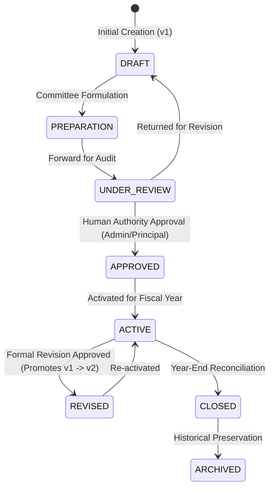

# PHASE 41 — Institutional Budget Planning, Financial Planning & Budget Control Engine
**Institution:** Eliotganj Hazi Rohmatollah Jamiria Madrasha (ইলিয়টগঞ্জ হাজী রহমাতুল্লাহ্ জমিরীয়া মাদরাসা)  
**Checkpoint:** `EHRJ-AI-2026-PHASE41`  
**Engine Directory:** `src/lib/budget/`  
**Console UI:** `src/app/admin/budgets/` & `src/components/budget/InstitutionalBudgetConsole.tsx`  
**Verification Suite:** `scratch/test_phase41_budget_engine.ts` (79/79 Tests Passed)

---

## 1. Executive Summary & Architectural Philosophy

Phase 41 delivers an institutional-grade **Budget Planning, Financial Planning & Budget Control Engine** tailored specifically for the governance of Eliotganj Hazi Rohmatollah Jamiria Madrasha.

### Core Architectural Invariants
1. **Separation of Planning vs. Execution:**  
   > *“PLAN THE MONEY, CONTROL THE MONEY, BUT NEVER DUPLICATE THE ACCOUNTING SOURCE OF TRUTH.”*  
   Phase 41 does **not** duplicate ledger transactions, cash vouchers, or payment journals. Actual cash inflows and outflows remain solely under the authority of **Phase 6 Finance (`CashTransaction`)**, purchase orders under **Phase 12 Procurement (`PurchaseOrder`)**, and salaries under **Phase 13 Payroll (`PayrollRecord`)**.
2. **Automate the Process, Not the Authority:**  
   No budget, version promotion, or revision can be approved autonomously by an AI agent or script. Formal status transitions require verified human administrative authority (`ADMIN` or `PRINCIPAL`).
3. **Strict Shariah & Purpose-Bound Fund Restrictions:**  
   Budget lines are partitioned across Islamic and institutional funds:
   - **General Fund (`GENERAL`):** Operational salaries, utilities, administrative maintenance.
   - **Lillah Boarding Fund (`LILLAH`):** Student boarding meals, grains, raw kitchen rations, cook salaries. Cannot be diverted to construction or unrelated capital assets.
   - **Zakat Welfare Fund (`ZAKAT`):** Exclusively for eligible orphan/destitute student welfare, clothing, medical aid, and study books. Explicitly blocks administrative/office expenditure.
   - **Construction & Development Fund (`CONSTRUCTION`):** Building construction, classroom expansion, capital renovation, plumbing, electrical infrastructure.
   - **Orphan & Sadaqah Fund (`ORPHAN`):** Specialized orphan patronage, boarding essentials, emergency stipends.
4. **Soft Control by Default:**  
   - 80% Utilization: Early Warning (Yellow)
   - 90% Utilization: Critical Warning (Orange)
   - 100%+ Utilization: Overrun Breach (Red) requires human justification or formal budget revision request.
5. **Strictly In-App & Calendar:**  
   Strictly **NO SMS**. Notifications are delivered via in-app alerts and calendar milestones.

---

## 2. Directory Structure & Key Modules

```
src/lib/budget/
├── types.ts                    # Complete TypeScript definitions & fund code schemas
├── budgetStore.ts              # Atomic JSON persistence (periods, budgets, revisions, projects, alerts, audits)
├── budgetLifecycleEngine.ts    # State machine (DRAFT -> PREPARATION -> UNDER_REVIEW -> APPROVED -> ACTIVE -> REVISED -> CLOSED)
├── budgetCalculationEngine.ts  # Variance analysis, utilization %, fund summaries, Shariah rule validators
├── budgetControlEngine.ts      # Multi-tiered threshold scanning (80%, 90%, 100%), early warnings & overruns
├── budgetRevisionEngine.ts     # Revision request, line diffing, approval & immutable version snapshots (v1 -> v2)
├── budgetIntegrationBridge.ts  # Read-only reconciliation with Phase 6, 12, 13, and Phase 26 forecasting
└── index.ts                    # Barrel export

src/app/api/admin/budgets/
├── route.ts                    # GET all budgets, POST new budget
├── [id]/route.ts               # GET budget detail with versions & lines, PATCH budget
├── [id]/action/route.ts        # POST lifecycle actions (submit, approve, activate, lock, close)
├── periods/route.ts            # GET/POST budget periods & lock/unlock
├── lines/route.ts              # GET/POST budget lines (with Shariah validation)
├── revisions/route.ts          # GET/POST revision requests & line diffs
├── revisions/[id]/approve/route.ts # POST approve/reject revision & promote version
├── projects/route.ts           # GET/POST capital projects linked to budget/construction
├── alerts/route.ts             # GET/POST threshold control alerts & acknowledgments
├── variance/route.ts           # GET budget variance calculations & utilization reports
└── stats/route.ts              # GET institutional dashboard KPIs

src/app/admin/budgets/
├── page.tsx                    # Main Institutional Budget Cockpit
├── periods/page.tsx            # Budget Periods Management view
├── new/page.tsx                # New Budget wizard view
├── projects/page.tsx           # Capital Projects tracking view
├── [id]/page.tsx               # Budget Detail & Lines view
├── [id]/versions/page.tsx      # Immutable Version History & Snapshots view
├── [id]/revisions/page.tsx     # Budget Revisions & Diff Analysis view
└── [id]/variance/page.tsx      # Variance & Threshold Early Warning view

src/components/budget/
└── InstitutionalBudgetConsole.tsx # Interactive 6-Tab Console with creation modals and real-time alerts
```

---

## 3. Budget Lifecycle & Version Snapshot Architecture



When a budget is approved, an **immutable version snapshot** is generated capturing:
- Complete budget header metadata
- Snapshot of all approved budget lines
- Net planned income & expense
- Human approver ID, name, role, and approval reference
- Timestamp

Any modifications in `ACTIVE` status are forbidden and must pass through a **Budget Revision Request** (`BudgetRevision`) with line diffs. Approval promotes the budget version (`v1` $\rightarrow$ `v2`) and archives the previous state permanently.

---

## 4. Variance & Control Threshold Formulae

### Expense Variance
$$\text{Remaining} = \text{Planned Expense} - (\text{Actual Expense} + \text{Committed})$$
$$\text{Variance} = \text{Planned Expense} - (\text{Actual Expense} + \text{Committed})$$
$$\text{Utilization Rate (\%)} = \frac{\text{Actual Expense} + \text{Committed}}{\text{Planned Expense}} \times 100$$

- $\text{Variance} \ge 0$: Favorable (within budget)
- $\text{Variance} < 0$: Unfavorable / Overrun (budget exceeded)

### Income Variance
$$\text{Variance} = \text{Actual Inflow} - \text{Planned Inflow}$$
$$\text{Achievement Rate (\%)} = \frac{\text{Actual Inflow}}{\text{Planned Inflow}} \times 100$$

- $\text{Variance} \ge 0$: Favorable (surplus or achieved target)
- $\text{Variance} < 0$: Shortfall (below revenue projection)

---

## 5. Automated Verification Results

The test suite (`scratch/test_phase41_budget_engine.ts`) executes 79 tests across 9 functional groups:

| Group | Functional Area | Tests | Status |
|:---|:---|:---:|:---:|
| 1 | Store & Seeding Integrity | 7 | ✅ 100% Passed |
| 2 | Budget Period Engine & Invariants | 2 | ✅ 100% Passed |
| 3 | Budget Lifecycle & State Transitions | 13 | ✅ 100% Passed |
| 4 | Budget Lines & Fund Allocation Restrictions | 10 | ✅ 100% Passed |
| 5 | Calculations, Variance & Utilization | 10 | ✅ 100% Passed |
| 6 | Budget Control Early Warning & Overrun Engine | 10 | ✅ 100% Passed |
| 7 | Budget Revision Workflow & Version Promotion | 15 | ✅ 100% Passed |
| 8 | Capital Projects & Milestone Tracking | 3 | ✅ 100% Passed |
| 9 | Authoritative Integration Bridge & Invariants | 9 | ✅ 100% Passed |
| **Total** | **All Phase 41 Test Suites** | **79** | **✅ 100% Passed** |

---

## 6. Regression Testing Verification

- **Phase 40 (Procurement & Contracts):** 38 / 38 Tests Passed (`npm run test:phase40`)
- **Phase 39 (Teacher/Staff Training & Certifications):** 40 / 40 Tests Passed (`npm run test:phase39`)
- **Strict Invariants:** Strictly 0 SMS invocations, strictly human approval authority, non-duplicative integration bridge.
