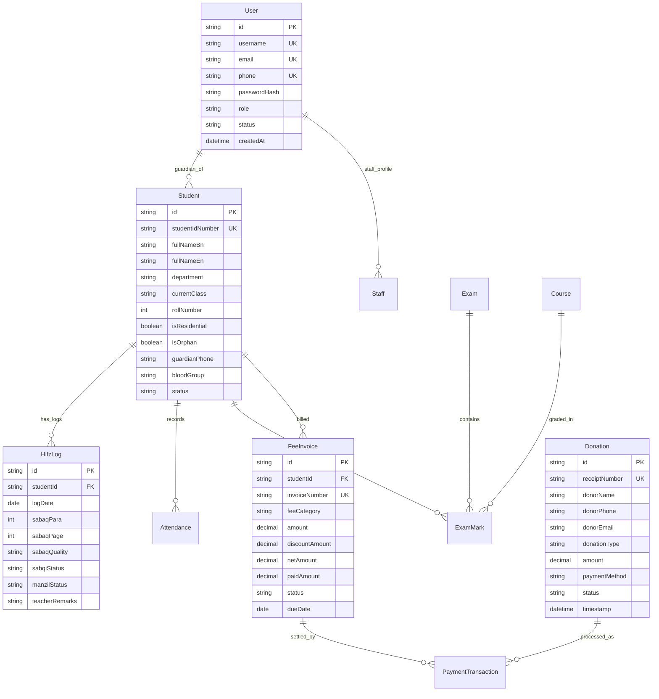

# Eliotgonj Hazi Rohmatollah Jamiria Madrasha Web Application
## Master Software Architecture & Implementation Plan (PROJECT_PLAN.md)

---

## 1. Executive Summary & Project Vision

### 1.1 Institution Context
**Eliotgonj Hazi Rohmatollah Jamiria Madrasha** (ইলিয়টগঞ্জ হাজী রহমত উল্লাহ জামিয়া মাদ্রাসা) is a renowned Islamic educational institution and orphanage located in Eliotganj, Daudkandi, Cumilla, Bangladesh. The institution provides multi-stream education comprising:
- **Noorani & Maktab Division** (নূরানী ও মক্তব বিভাগ) – Early childhood Quran recitation and foundational Islamic & general literacy.
- **Tahfeez-ul-Quran (Hifz) Division** (হিফজুল কুরআন বিভাগ) – Memorization of the Holy Quran with Sabaq (سبق), Sabqi (سبقی), and Manzil (منزل) monitoring.
- **Kitab Division** (কিতাব বিভাগ) – Comprehensive Islamic jurisprudence, Hadith, Tafsir, and Arabic literature alongside national general curriculum.
- **Orphanage & Lilah Boarding** (এতিমখানা ও লিল্লাহ বোর্ডিং) – Residential lodging, food, medical care, and clothing for orphan and underprivileged students.
- **Darul Ifta / Fatwa & Guidance** (দারুল ইফতা) – Community religious counsel and legal rulings.

### 1.2 The Problem Statement
Currently, administrative, academic, and financial operations are managed manually across physical paper ledgers, printed registers, and cash receipts. This causes:
1. Significant administrative burden during admissions, examination marks calculation, and result compilation.
2. Inefficient tracking of Hifz students' daily progress (Sabaq, Sabqi, Amokhta/Manzil).
3. Risk of human error and lack of transparency in Lilah boarding donations, Zakat/Sadaqah collections, and student fee reconciliation.
4. Absence of instant guardian communication (absence alerts, fees dues, exam results).
5. Lack of a modern digital public portal to showcase the madrasah’s historical legacy, annual conferences (Jalsa/Waz Mahfil), and donor transparency.

### 1.3 The Solution
A unified, state-of-the-art **Web Portal & Integrated Madrasah Management ERP System** engineered with enterprise-grade security, trilingual support (**Bengali, Arabic, and English**), modern Islamic aesthetics, offline-first receipt printing, and complete role-based governance.

---

## 2. Stakeholders & Role-Based Access Control (RBAC)

| Role | Bengali Title | Responsibilities & Access Scope |
| :--- | :--- | :--- |
| **Super Admin / Muhtamim** | মুহতামিম / মহাপরিচালক | Full systemic authority: institutional settings, financials, approvals, audit logs, staff management, role delegation. |
| **Academic Admin / Nazim-e-Taleemat** | নাজিম-এ-তা'লীমাত / শিক্ষা সচিব | Admissions, academic calendars, curriculum, class schedules, exam scheduling, grade validation, teacher allocations. |
| **Teacher / Ustad / Asatizah** | উস্তাদ / শিক্ষক | Daily student attendance, daily Hifz tracking (Sabaq/Sabqi/Manzil), marks entry, student behavioral remarks, syllabus progress. |
| **Accountant / Nazim-e-Maliyat** | নাজিম-এ-মালিয়াত / হিসাবরক্ষক | Fee collection, voucher generation, donations (Zakat, Lilah, General, Sadaqah), vendor expenses, payroll, financial auditing. |
| **Boarding / Hostel Superintendent** | মেস / লিল্লাহ বোর্ডিং তত্ত্বাবধায়ক | Student hostel allocations, daily meal counts, kitchen inventory, food stock ledger, health records. |
| **Student / Talib-e-Ilm** | তালেবে ইলম / শিক্ষার্থী | View own profile, daily routine, exam schedules, digital report cards, fee ledger, library loans. |
| **Guardian / Abhibhabok** | অভিভাবক | Access child's attendance records, Hifz daily progress, fee payment portal, result cards, direct notice desk. |
| **Donor / Mutawalli / General Public** | দাতা / সাধারণ শুভানুধ্যায়ী | Public landing page, institution history, photo gallery, notices, direct online donation (bKash/Nagad/Cards) with instant 80G/e-receipt. |

---

## 3. Technology Stack & Architecture

### 3.1 Architectural Philosophy
- **Modular Monolith / Clean Architecture**: Maximum maintainability, high performance, single repository simplicity with clear separation of concerns (Domain, Application, Infrastructure, Presentation).
- **Responsive Mobile-First UI**: 85%+ of parents, donors, and teachers in Bangladesh access software via mobile smartphones (Android/iOS).
- **Trilingual Localization Engine (i18n)**: Native Bengali (বাংলা) as primary, Arabic (العربية) with proper RTL layout for Quranic/Kitab terms, and English for administrative export/reporting.
- **Print & PDF Engine**: Thermal POS receipt printing for counter collections, and high-fidelity vector PDF generation for ID cards, Admit Cards, and Tabulation Sheets.

```
┌────────────────────────────────────────────────────────────────────────┐
│                   PRESENTATION LAYER (Next.js 14 App Router)           │
│   Public Portal  │  Admin ERP  │  Teacher App  │  Parent/Student View  │
└────────────────────────────────────────────────────────────────────────┘
                                    │
                                    ▼
┌────────────────────────────────────────────────────────────────────────┐
│             APPLICATION & SERVICES LAYER (Server Actions & REST)        │
│  Auth (JWT/Sessions) │ Admissions │ Hifz Tracker │ Accounts │ Exams     │
└────────────────────────────────────────────────────────────────────────┘
                                    │
                                    ▼
┌────────────────────────────────────────────────────────────────────────┐
│                   DATA & INFRASTRUCTURE LAYER                          │
│   Prisma ORM │ PostgreSQL / SQLite │ Redis Cache │ Cloud Object Store  │
└────────────────────────────────────────────────────────────────────────┘
```

### 3.2 Core Tech Stack Matrix
- **Frontend Framework**: Next.js 14 / React 18 with TypeScript.
- **Styling & Design System**: Tailwind CSS with custom Islamic design tokens (Emerald Green, Gold Foil, Warm Cream, Midnight Slate), Lucide Icons, and `@tailwindcss/forms`.
- **Typography**:
  - Bengali: `Hind Siliguri` & `Noto Sans Bengali` (Google Fonts).
  - Arabic: `Amiri` & `Scheherazade New` (Quranic & Hadith rendering).
  - English & Numbers: `Inter` & `Outfit`.
- **ORM & Database**:
  - Database: PostgreSQL (Production) / SQLite (Local Zero-Config Dev & Automated Test Environment).
  - Schema Management: Prisma ORM with strict foreign-key cascades and indexing.
- **Authentication & Security**:
  - Jose / JWT / Session cookies with `HttpOnly`, `SameSite=Lax`, and `Secure` flags.
  - Password hashing: `bcryptjs` (salt rounds: 12).
  - Rate limiting: Sliding-window memory rate limiter on authentication and payment endpoints.
- **Payment Gateway Integration**:
  - Local MFS Gateways: bKash PGW (Tokenized Checkout), Nagad Direct, Rocket, and SSLCommerz for multi-channel debit/credit cards.
- **Reporting & Document Rendering**:
  - Printable HTML-to-PDF / `@react-pdf/renderer` / Browser Native Print CSS stylesheets with exact `@media print` dimensions (80mm POS receipt, A4 Marksheet, CR80 Student ID card).
- **QR Code & Barcoding**: `qrcode` generator for verifiable student ID cards, fee receipts, and digital result authenticity verification.

---

## 4. UI/UX Design System & Aesthetics

### 4.1 Color Palette
- **Primary Brand / Islamic Emerald**: `#0D5C3A` (Deep Forest Madrasah Green - symbolizes knowledge, peace, and tradition).
- **Primary Accent / Gold Leaf**: `#C59B27` / `#D4AF37` (Islamic geometric illumination and royal accents).
- **Secondary Dark / Deep Night Slate**: `#0B1914` (Header bars, dark-mode surface, high-contrast typography).
- **Neutral Background / Sand & Ivory**: `#F9F8F3` (Soft warm page background reducing eye strain).
- **Card & Surface White**: `#FFFFFF` with soft borders (`#E5E7EB` / `#E2E8F0`).
- **Semantic Feedback**:
  - Success: `#059669` (Passed, Paid, Present)
  - Warning: `#D97706` (Due, Late, Pending Approval)
  - Danger: `#DC2626` (Failed, Absent, Expelled)
  - Info: `#0284C7` (Notices, Announcements)

### 4.2 Micro-Interactions & Usability
- High-contrast touch targets (minimum 44x44px for smartphone finger taps).
- Instant live search & debounce filtering on student tables, fee ledgers, and donor registries.
- Skeleton loaders during data fetch; zero layout shift (CLS < 0.05).
- Print preview modals with dedicated 1-click thermal receipt printing.

---

## 5. Functional Module Specifications

### Module 1: Institutional Public Portal & Landing Page
1. **Hero Section**:
   - High-resolution campus presentation, institution name in Arabic calligraphy, Bengali, and English.
   - Core statistics counter: Total Students, Qualified Hafiz-e-Quran, Dedicated Teachers, Orphan Beneficiaries.
   - Quick CTA: "ভর্তি আবেদন" (Online Admission) & "দান করুন / ডোনেশন" (Donate Now).
2. **About & History**:
   - Founding story of Hazi Rohmatollah, foundation year, mission, vision, and Muhtamim's official message.
3. **Departments & Courses**:
   - Noorani & Najera, Tahfeez-ul-Quran, Kitab (Mizan to Daura-e-Hadith/Masters equivalent), Modern General Education (Bangla, English, Math, ICT).
4. **Notice & Circular Board**:
   - Searchable, downloadable PDF circulars (Admission notice, Vacation announcements, Jalsa schedules).
5. **Photo & Video Gallery**:
   - Campus infrastructure, Prize distribution ceremonies, Annual Dastarbandi (দস্তারবন্দী মাহফিল - Hifz graduation).
6. **Prayer Times & Hijri Calendar Widget**:
   - Daily 5 waqt Salah timing for Cumilla/Eliotganj district with current Hijri date calculation.
7. **Contact & Location**:
   - Interactive Google Map embed, emergency contact numbers, email, and social links.

---

### Module 2: Online Admission & Student Registration
1. **Public Admission Application Form**:
   - Student Full Name (Bangla & English), Date of Birth, Birth Registration Certificate No (BRN).
   - Father's & Mother's details, Guardian NID, WhatsApp number, emergency contact.
   - Department selection (Noorani, Hifz, Kitab, Day-care / Residential / Orphan Lilah).
   - Previous madrasah/school information and upload of passport photo.
2. **Admission Processing Workflow**:
   - `Submitted` ➔ `Admit Card Generated` ➔ `Admission Exam / Interview` ➔ `Approved / Rejected` ➔ `Roll & Section Allocated`.
3. **Automated Admit Card**:
   - Downloadable printable PDF with unique Application Tracking PIN and venue instructions.

---

### Module 3: Tahfeez-ul-Quran (Hifz) Digital Tracker
*A specialized module designed for traditional Quranic pedagogy:*
1. **Daily Sabaq (سبق - New Lesson)**:
   - Para number, Surah, Ayah range, quality rating (Mumtaz/A+, Jayyid Jiddan/A, Jayyid/B, Maqbool/C, Daaif/Needs Repeat).
2. **Sabqi (سبقی - Recent Quarter / Half Para Review)**:
   - Tracking daily review of the current ongoing Para (আমপারা / সংশ্লিষ্ট পারা).
3. **Amokhta / Manzil (منزل - Distant Revision)**:
   - Daily 1/2 to 1 Para recitation from past memorized Paras to preserve Quran retention.
4. **Parent Progress View**:
   - Real-time progress bar: "Total Paras Completed: 18 / 30", current memorization speed, and teacher remarks.

---

### Module 4: Student Information System (SIS) & Digital ID Cards
1. **Comprehensive Student Master Record**:
   - Student Unique ID (Format: `ERJM-YYYY-DEPT-XXXX`), Blood group, Medical notes, Guardian contact.
2. **Status Tracking**:
   - Active, Transferred (Chharpotro/ছাড়পত্র), Graduated (Hafiz/Alim), Boarding Resident, Non-Resident.
3. **Digital Smart ID Card Generator**:
   - Dual-sided CR80 standard printable format with student photo, barcode, and QR code pointing to online verification URL.

---

### Module 5: Attendance & Leave Management
1. **Daily Attendance Register**:
   - Bulk class-wise marking: `Present` (উপস্থিত), `Absent` (অনুপস্থিত), `Late` (দেরি), `Excused Leave` (ছুটি).
2. **Teacher & Staff Attendance**:
   - Daily punch-in/punch-out tracking with monthly deduction logic for unapproved absences.
3. **SMS Gateway Alerts**:
   - Automatic trigger: When a day-care student is marked absent without prior notice, an instant SMS alert is prepared for the guardian's phone.

---

### Module 6: Examination, Marks & Tabulation Sheet (Natija)
1. **Exam Configuration**:
   - First Term (প্রথম সাময়িক), Mid Term (দ্বিতীয় সাময়িক), Annual (বার্ষিক পরীক্ষা), and Monthly Evaluation (মাসিক মূল্যায়ন).
2. **Subject & Grading Scheme**:
   - Quran, Hadith, Fiqh, Nahw-Sarf, Arabic Literature, Bengali, English, Mathematics, General Science.
   - Madrasah standard grading system:
     - `Mumtaz` (মুমতাজ - 80% to 100%)
     - `Jayyid Jiddan` (জায়্যিদ জিদ্দান - 65% to 79%)
     - `Jayyid` (জায়্যিদ - 50% to 64%)
     - `Maqbool` (মাকবুল - 33% to 49%)
     - `Rasib` (রাসিব / ফেল - 0% to 32%)
3. **Tabulation Sheet & Transcripts**:
   - One-click generation of institutional marksheets (নম্বরপত্র / রেজাল্ট কার্ড) with official watermark and Muhtamim signature line.
4. **Public Result Portal**:
   - Public search portal where parents enter Student ID and Exam Session to view/download results.

---

### Module 7: Accounts, Fee Management & Money Receipts
1. **Fee Structures**:
   - Admission fee, monthly tuition fee, residential boarding charges, examination fee, book charges.
   - Concession / Scholarship / Free-ship discount tags for orphan and needy students.
2. **Counter Fee Collection (Cash Counter)**:
   - Select student ID ➔ Pending dues load automatically ➔ Enter amount ➔ Select Cash / bKash / Nagad ➔ Print dual receipt (1 for Student, 1 for Madrasah copy).
3. **Income & Expense Book (Cashbook)**:
   - Multi-category accounting: General Fund, Lilah Boarding Fund, Mosque Fund, Construction Fund, Staff Salary.
   - Daily, Monthly, and Annual Income vs Expense reports with balance sheet export.

---

### Module 8: Lilah Boarding, Orphanage & Sponsor-A-Yateem
1. **Orphan & Underprivileged Register**:
   - Verification documents, guardian death certificates, financial background verification.
2. **Donor "Sponsor An Orphan" Portal**:
   - Direct sponsorship options (Monthly 2,500 BDT or Annual 30,000 BDT for food, accommodation, and books).
   - Anonymized student progress reports sent securely to the sponsor.
3. **Mess & Food Inventory**:
   - Daily grocery purchase log (Rice, lentils, oil, fish, meat), daily student meal attendance, stock depletion warnings.

---

### Module 9: Online Donations & Donor Transparency Desk
1. **Multi-Channel Donations**:
   - Zakat Fund (যাকাত ফান্ড - strictly shariah-compliant for Lilah boarding & poor students).
   - Sadaqah & Lilah Boarding Fund (সদকা ও বোর্ডিং তহবিল).
   - Madrasah Construction & Development Fund (উন্নয়ন ও নির্মাণ তহবিল).
   - General Charity / Lillah Jafiran Fund.
2. **Instant Donation Verification & Money Receipt**:
   - Donors receive an automated PDF Money Receipt with institution registration number and official seal.
3. **Top Donors & Waqf Register**:
   - Permanent donors (আজীবন সদস্য / মুতাওয়াল্লী) registry with dedicated ledger.

---

### Module 10: Human Resources & Staff Payroll
1. **Faculty & Staff Directory**:
   - Teacher profiles, educational credentials (Doraim/Kamil/Qawmi certificates), designation, appointment date.
2. **Monthly Payroll Automation**:
   - Basic salary, housing allowance, meal allowance, advance deductions, final monthly salary disbursement slip.
3. **Teacher Leave Ledger**:
   - Casual leave, sick leave, Eid vacation records.

---

## 6. Database Schema Design (Prisma Data Model)



---

## 7. Phased Implementation Roadmap & Verification Plan

```
PHASE 1: Foundation & Public Identity
├── Project Architecture & Tailwind Islamic Theme Setup
├── Multilingual i18n & Static Landing Page
├── Public Notices, Photo Gallery & Waqt Prayer Clock
└── Verified & Tested: Browser Responsive & Fast LCP < 1.2s

PHASE 2: Authentication, SIS & Admissions
├── RBAC System (Admin, Teacher, Accountant, Guardian)
├── Student Lifecycle & Admissions Workflow
├── Digital CR80 ID Card & Admit Card Generator with QR Code
└── Verified: CRUD + Security & Persistence Testing

PHASE 3: Academic, Attendance & Hifz Tracker
├── Classroom Management & Syllabus Schedules
├── Daily Attendance Engine with SMS Payload Prep
├── Tahfeez-ul-Quran (Hifz) Daily Sabaq/Sabqi/Manzil Ledger
└── Verified: Teacher UI test on mobile viewport + data persistence

PHASE 4: Examination, Grading & Report Cards
├── Exam Creation & Mark Entry Portal
├── Automatic Grading Algorithm (Mumtaz, Jayyid, Maqbool, Rasib)
├── High-Fidelity Vector PDF Marksheet & Public Result Check
└── Verified: Calculation checks + PDF download & print alignment

PHASE 5: Accounts, Fees, Lilah & Donation Gateway
├── Fee Invoicing & Dual-copy POS Receipt Printing
├── Cashbook & Multi-fund Ledger (Zakat, Lilah, General)
├── Online Donation Gateway (bKash/Nagad/SSLCommerz Mock & Live)
├── Lilah Boarding Grocery & Meal Inventory
└── Verified: Financial audit balance + Replay attack prevention

PHASE 6: Hardening, Regression Testing & Final Delivery
├── OWASP Security Audit (IDOR, XSS, CSRF, SQLi verification)
├── Cross-device testing (Mobile, Tablet, Desktop)
├── Automated E2E User Flow Tests
└── Final Signoff & Comprehensive Documentation

PHASE 36: Alumni, Former Student & Community Relationship Management Engine (EHRJ-AI-2026-PHASE36)
├── Core Invariant: Relationship layer, zero student master duplication
├── Verification Engine (Pending -> Verified -> Active -> Opted Out -> Archived)
├── Privacy Sanitization & Anti-Scraping Defense (Max 50 records/query)
├── Community Groups (Batch Year, Professional, Regional, Volunteer)
├── Controlled Mentorship Workflow (Student Request -> Admin Facilitation -> Connection)
├── Volunteer Opportunities & Verified Service Hours Ledger
├── Financial Contributions linked to Phase 6 Funds (Zakat, Lillah, etc.) & In-kind gifts
├── Legacy Batch Import Engine with Phone/Email/Name-Year Duplicate Diagnostics
├── Portals: Public Directory (/alumni/directory), Personal Portal (/portal/alumni), Admin Cockpit (/admin/alumni)
└── Verified: 37/37 Phase 36 Tests Passed, 233/233 Cumulative Regression Tests Passed

PHASE 37: Institutional Survey, Feedback, Assessment & Voice-of-Community Engine (EHRJ-AI-2026-PHASE37)
├── Core Invariant: Feedback informs decisions; never autonomously makes high-stakes decisions (assertNoHighStakesDecisionMutation)
├── Survey Lifecycle State Machine (DRAFT -> REVIEW -> APPROVED -> PUBLISHED -> OPEN -> CLOSED -> ANALYZING -> COMPLETED -> ARCHIVED)
├── Immutable Published Versions (v1 -> v2) preserving historical response binding
├── Audience Snapshot captured at publication
├── Response Modes: Identified, Pseudonymous, and Anonymous with technical PII segregation
├── Small-Group Protection (< 5 response threshold suppression)
├── Conditional Question Visibility Engine & Option Validation
├── Response Engine with Duplicate Protection & Save/Resume Draft
├── Bounded AI Qualitative Theme Summaries (permanently tagged humanReviewRequired: true)
├── Institutional Improvement Actions Lifecycle & Phase 14 Help Desk Ticket Bridge (EHRJ-REQ-YYYY-XXXXXX)
├── Strictly NO SMS (Portal, In-app notice, Email)
├── Frontend: Public Hub (/surveys), Interactive Form (/surveys/[id]), Portal (/portal/surveys), Admin Cockpit (/admin/surveys, /admin/surveys/[id])
└── Verified: 43/43 Phase 37 Tests Passed, 276/276 Cumulative Regression Tests Passed

PHASE 38: Institutional Knowledge, SOP, Policy, Handbook & Governance Document Management Engine (EHRJ-AI-2026-PHASE38)
├── Core Invariant: One authoritative policy, one controlled version; Phase 38 owns authority, Phase 22 owns RAG
├── Document Master Engine (Policies, SOPs, Handbooks, Guidelines, Rules, Memos)
├── Lifecycle State Machine (DRAFT -> UNDER_REVIEW -> APPROVED -> PUBLISHED -> EFFECTIVE -> SUPERSEDED -> EXPIRED -> ARCHIVED -> WITHDRAWN)
├── Immutable Versioning (v1.0 -> v1.1 minor, v2.0 major) preserving historical versions
├── Historical Effective-Date Engine: Resolves authoritative policy version for any past date
├── Legal Hold / Institutional Hold: Prevents archival, withdrawal, or deletion under legal/administrative inquiry
├── Principal Oversight & Approval Workflow with detailed audit provenance
├── Mandatory Role-Targeted Digital Acknowledgements (Teachers, Staff) & Compliance Metrics
├── Automated Policy Conflict Detection Scanner (Duplicate categories, overlapping dates, superseded collisions)
├── Authorized, Scoped & Time-Bounded Policy Exceptions Management
├── SOP Operational Steps Engine with Roles, Decision Points & Phase 27 Workflow Links
├── Handbook Engine with Multi-Level Table of Contents Navigation
├── Phase 22 RAG Sync Bridge: Auto-syncs approved/effective policies to Phase 22 knowledge store
├── Strictly NO SMS (In-app portal notices & calendar reminders only)
├── Frontend: Public Knowledge Hub (/knowledge), User Acknowledgement Console (/portal/knowledge), Admin Cockpit (/admin/knowledge, /admin/knowledge/documents, /admin/knowledge/reviews, /admin/knowledge/acknowledgements, /admin/knowledge/conflicts)
└── Verified: 55/55 Phase 38 Tests Passed, 173/173 Next.js Routes Production Build Clean

PHASE 39: Teacher/Staff Training, Professional Development & Certification Engine (EHRJ-AI-2026-PHASE39)
├── Core Invariants: Phase 13 owns authoritative employee master; training attendance separate from HR/payroll; assessment does not affect academic grades
├── Training Program Lifecycle (DRAFT -> REVIEW -> APPROVED -> PUBLISHED -> REGISTRATION_OPEN -> SCHEDULED -> IN_PROGRESS -> COMPLETED -> ARCHIVED)
├── Session Scheduling with Phase 33 Calendar Synchronous Payload
├── Transactional Participant Enrollment with Strict Capacity Validation & Automatic Waitlisting
├── Training Attendance Engine with QR Verification & Recalculated Attendance Percentage
├── Professional Assessment Engine with Answer Key Redaction, Automated Quiz Grading & Instructor Evaluation
├── Verifiable Certificate Engine with Phase 7/29 Tokens (VER-TRN-YYYY-XXXX) & Idempotent Issuance
├── Certificate Validity & Expiration Renewal Workflow (VALID -> EXPIRING_SOON -> EXPIRED -> RENEWED)
├── Phase 13 Non-Duplicative Employee Training Profile Integration Bridge & Professional Development Plans
├── Strictly NO SMS (In-app portal alerts and calendar schedules only)
├── Frontend: Admin Cockpit (/admin/training, /admin/training/programs, /admin/training/sessions, /admin/training/participants, /admin/training/assessments, /admin/training/certificates, /admin/training/renewals)
├── Frontend: Teacher/Staff Portal (/portal/training, /portal/training/[id], /portal/training/certificates)
└── Verified: 40/40 Phase 39 Tests Passed, 98/98 Cumulative Phase 37-38 Regression Tests Passed, Next.js Production Build Clean across 185+ routes
```

---

## 8. Definition of Done (DoD) & Verification Criteria
Following the **Universal Master Software Build Rule**:
1. **Design Integrity**: Vibrant Islamic aesthetics, emerald-gold palette, clean typography, responsive layout across all screen breakpoints.
2. **Data Persistence**: Zero mock reliance in final integration—every form submission must persist to the database and survive application restarts.
3. **Print Precision**: All receipts (80mm), admit cards (A4), and result cards must render cleanly in print mode without clipping or overflow.
4. **Security Hardening**: Strict server-side RBAC validation on all routes and Server Actions; passwords hashed with bcrypt; parameterized SQL via Prisma.
5. **Real User Verified**: End-to-end user journeys tested from public admission submission to accountant approval, attendance tracking, and marksheet generation.
